# 一、Introduction

## 1.1 什么是机器学习？

- **机器学习的定义**
    - 程序通过经验 $E$`(Experience经验)`，让自己完成任务 $T$`(Task任务)` 的能力不断提高，而提高了多少由指标 $P$`(Performance measure性能指标)` 来衡量

## 1.2 监督学习Supervised Learning

### 1.2.1 监督学习的定义

对于监督学习，我们一般会给出的训练集形如 

$$
D=\{(x^{(1)},y^{(1)}),(x^{(2)},y^{(2)}),\dots,(x^{(m)} ，y^{(m)})\}
$$

其中 $x^{(i)}$ 表示第 $i$ 个**输入样本**，一般被我们称作 **feature(特征)** ，而 $y^{(i)}$ 表示与之对应的第 $i$ 个**输出样本**，一般被称作 **label/target(标签/目标值)**，而数据集 $D$ 也被叫做 **labeled dataset(标签数据集)**

我们希望算法能够学习这些 **输入-输出样本** ，得到一个**近似映射关系** $\hat{f}$ 。
并能根据**预测值** $\hat{y}$ 和**真实值** $y^{(i)}$ 之间的**损失(loss)**或**代价函数(cost function)**，不断调整模型参数，使得最终得到的 **$\hat{f}(x^{(i)}) = \hat{y}^{(i)}$** 能够满足

$$
\hat{f}(x^{(i)}) \approx y^{(i)}
$$

并对于陌生输出 $x_{\text{new}}$ ，能够给出合理的预测：

$$
\hat y_{\text{new}}=\hat f(x_{\text{new}})
$$

### 1.2.2 监督学习的类型

$$
\text{监督学习}
\begin{cases}
\text{回归Regression} & \rightarrow \text{连续数值预测，y为连续值(房价预测)}\\
\text{分类Classification} & \rightarrow \text{分类，y为离散量(垃圾邮件分类)}
\end{cases}
$$

<div style="display: flex; gap: 20px; justify-content: center;">

  <figure style="text-align: center;">
    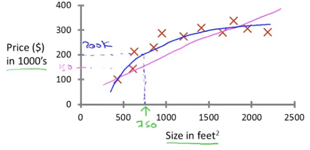
    <figcaption>图 1.1 回归问题</figcaption>
  </figure>

  <figure style="text-align: center;">
    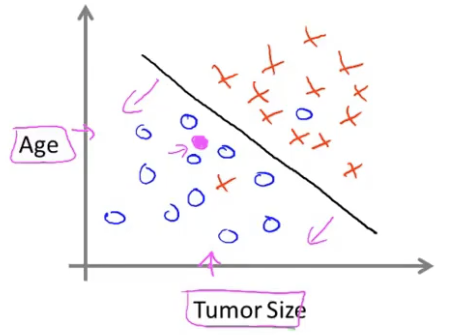
    <figcaption>图 1.2 分类问题</figcaption>
  </figure>

</div>

---

## 1.3 无监督学习Unsupervised Learning

### 1.3.1 无监督学习的定义

无监督学习是指：训练数据**没有人为提供的目标输出** $y$，算法只观察输入数据 $x$，并尝试发现数据自身潜在的结构、规律或表示。

与监督学习不同，无监督学习给出的数据集仅有特征集：

$$
D=\{x^{(1)},x^{(2)},\dots,x^{(m)}\}
$$

而我们希望算法做到的则是：

$$
x\rightarrow\text{发现 }x\text{ 本身的结构}
$$

### 1.3.2 无监督学习的类型

无监督学习的任务类型大致都是**没有目标y，寻找自身x的结构**。而由于这个所谓的**结构**并没有一个明确的定义，往往需要根据具体情况具体分析，因此无监督学习也没有一个很明确的类型划分。下文我们将介绍一种比较经典的无监督类型：**聚类Clustering**

简单的说，聚类就是**将相似的数据点分组在一起**。与监督学习中的**分类问题**不同，分类是**规定好了类别**，算法的任务是将陌生输入放入对应类别中，而聚类则**没有规定的类别**，算法的任务是自己去归纳总结出类别来。
举个例子，现在有一个集合 $D = \{-2, -1, 0, 1, 2\}$ 。在分类中，我们会规定好 $Odd = \{-1, 1\}$ 为奇数集， $Even = \{-2, 0, 2\}$ 为偶数集，之后我们输入一个数字 $3$ ，算法会自动将其分类到奇数。而聚类则是去自行找寻结构，根据任务的不同，算法的输出可能是和上面一样的奇偶分类，也可能出现**正整数、负整数、0**这种分类。

---
---
---

# 二、一元线性回归

## 2.1 线性回归模型

### 2.1.1 符号解释

**训练集**中， $m$ 表示样本总数，$i$ 表示第 $i$ 对样本

|i|x|y|
|:-:|:-:|:-:|
|(1)|2104|400|
|(2)|1416|232|
|(3)|1534|315|
|(...)|...|...|
|(m)| $x^{(m)}$ | $y^{(m)}$ |

$x \rightarrow f \rightarrow \hat{y}$ 中， $f$ 被称为**模型model**， $\hat{y}$ 被称为**target $y$ 的预测prediction/estimate**

一元线性回归的模型一般可以被描述为：

$$
f_{w,b}(x) = wx + b
$$

其中 $w$ 和 $b$ 均为标量，一般被称为**参数Parameters/系数coefficients/权重weights**，且 $f$ 下标可忽略不写

---

## 2.2 代价函数

在一元线性回归中，最经典和常用的代价函数就是**平方误差代价函数**：

$$
J(w,b) = \frac{1}{2m} \sum_{i=1}^{m}(\hat y^{(i)}-y^{(i)})^2
$$

或者将 $f_{w,b}(x) = \hat{y}^{(i)} = wx + b$ 展开后：

$$
J(w,b) = \frac{1}{2m} \sum_{i=1}^{m}(wx + b-y^{(i)})^2
$$

其中**误差error**项为 $(\hat y^{(i)}-y^{(i)})$ ，前面的 $\frac{1}{2}$ 是为了后续求导后计算更整洁，不影响计算结果。

现在，我们就拥有了一个二元方程，为了最小的误差，我们的目的就是:

$$
\underset{w,b}{\text{minimize}}\ J(w,b)
$$

即求得一对**最优参数** $(w^{*}, b^{*})$ ，使得：

$$
(w^*,b^*) = \arg\min_{w,b} J(w,b)
$$

<div style="display: flex; gap: 20px; justify-content: center;">

  <figure style="text-align: center;">
    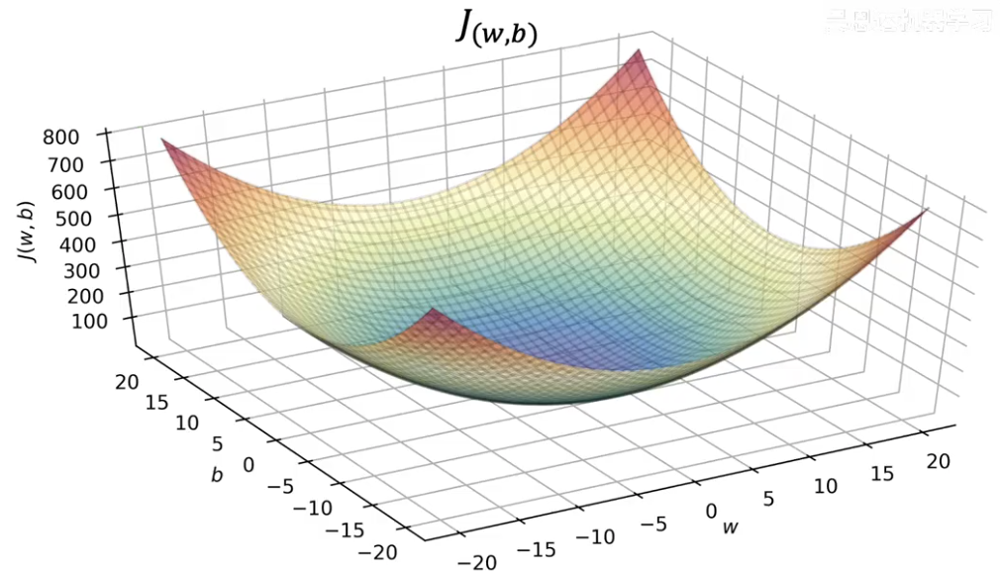
    <figcaption>代价函数</figcaption>
  </figure>

  <figure style="text-align: center;">
    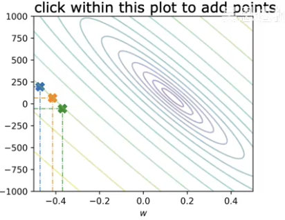
    <figcaption>等高线</figcaption>
  </figure>

</div>

---

## 2.3 梯度下降Gradient Descent

梯度下降，顾名思义，我们要先了解一下**梯度**：

$$
\nabla J(w,b)
=
\begin{bmatrix}
\dfrac{\partial J}{\partial w}\\[10pt]
\dfrac{\partial J}{\partial b}
\end{bmatrix}
$$

**梯度是一个向量**，而我们平常使用的偏导数，其实是**梯度向量的一个分量**
而当我们想表示，从当前点沿某个单位方向 $\mathbf{u}$ 移动，那这个方向上 $J$ 的变化率就被叫做**方向导数**：

$$
D_{\mathbf u}J
=
\nabla J\cdot\mathbf u
$$

根据**向量点乘的性质**，我们可以将 $\nabla{J} \cdot \mathbf{u}$ 这一项展开：

$$
D_{\mathbf{u}}J 
= \|\nabla J\|\|\mathbf u\|\cos\theta
= \|\nabla J\|\cos\theta
$$

很明显，当 $\theta = 0$ 时，该方向导数最大。
因此 $\nabla J$ 就是**函数增长最快的方向**，而加个负号， $-\nabla J$ 就是**函数下降最快的方向**

综上，假设我们将参数定义为一个参数向量：

$$
\boldsymbol\theta
=
\begin{bmatrix}
  w\\b
\end{bmatrix}
$$

那么我们的更新方程就出来了：

$$
\boldsymbol\theta_{\text{new}}
=
\boldsymbol\theta_{\text{old}}
-
\alpha\nabla J(\boldsymbol\theta_{\text{old}})
$$

即沿着**函数下降最快的方向**走一段距离。
当然，我们也可以把它展开写，就变成了这样：

$$
\begin{cases}
  w_{j} = w_{j} - \alpha\dfrac{\partial J(\vec{w}, b)}{\partial w_{j}}\\
  b = b - \alpha\dfrac{\partial J(\vec{w}, b)}{\partial b}
\end{cases}
$$

展开后：

$$
\begin{cases}
  w_{j} = w_{j} - \alpha[\frac{1}{m}\sum_{i=1}^{m}(f_{\vec{w}, b}(\vec{x}^{(i)}) - y^{(i)})x_{j}^{(i)}]\\[5pt]
  b = b - \alpha[\frac{1}{m}\sum_{i=1}^{m}(f_{\vec{w}, b}(\vec{x}^{(i)}) - y^{(i)})]
\end{cases}
$$

---
---
---

# 三、多元线性回归

## 3.1 多元特征

| i | $x_{1}$ | $x_{2}$ | $x_{3}$ | ... | $x_{n}$ | y |
| :-: | :-: | :-: | :-: | :-: | :-: | :-: |
| (1) | 2104 | 5 | 1 | ... | $x^{(1)}_{n}$ | 400 |
| (2) | 1416 | 3 | 2 | ... | $x^{(2)}_{n}$ | 232 |
| (3) | 1534 | 2 | 2 | ... | $x^{(3)}_{n}$ | 400 |
| (...) | ... | ... | ... | ... | ... | ... |
| (m) | $x^{(m)}_{1}$ | $x^{(m)}_{2}$ | $x^{(m)}_{3}$ | ... | $x^{(m)}_{n}$ |$y^{(m)}$|

**共有n个特征**，每个 $x^{i}$ 表示一个张量，例如：

$$
\vec{x}^{(2)}
=
\begin{bmatrix}
  1416\\3\\2\\\dots\\x^{(2)}_{n}
\end{bmatrix}
$$

在引入多元特征后，我们可以写出线性回归方程的一般形式：

$$
f_{w_{1}, w_{2}, w_{3}, \dots ,b}(x) = w_{1}x_{1} + w_{2}x_{2} + w_{3}x_{3} + \dots + b
$$

或者：

$$
f_{\vec{w},b}(\vec{x}) = \vec{w} \cdot \vec{x} + b
$$

其中：

$$
\vec{w}
=
\begin{bmatrix}
  w_{1}\\w_{2}\\\dots\\w_{n}
\end{bmatrix}
$$

$$
\vec{x}
=
\begin{bmatrix}
  x_{1}\\x_{2}\\\dots\\x_{n}
\end{bmatrix}
$$

---

## 3.2 特征缩放

### 3.2.1 为什么要进行缩放？

我们假设一种情况： 

$$
\hat{\text{price}}
=
w_{1}x_{1} + w_{2}x_{2} + b
$$

$$
x_{1}
\in
[300, 2000]
$$

$$
x_{2}
\in
[0, 5]
$$


其中 $\hat{\text{price}}$ 表示**房子的估价**， $x_{1}$ 表示**占地面积($m^2$)**， $x_{2}$ 表示**卧室的数量**。此时，我们以这两个特征绘制出来的**散点图**，以及由 $w_{1}$ 和 $w_{2}$ 绘制出来的**等高线**图可能长这样：

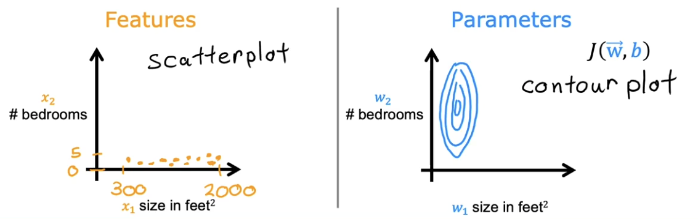

可以看到，由于 $x_{1}$ 的取值远大于 $x_{2}$ 的取值，导致散点图的数据都被挤在一起，并且由于一点轻微的 $w_{1}$ 变化都会引起最终**房价**和**误差**的巨大变化，等高线图也被挤在了一起。

那么这会导致什么问题呢？他会直接影响到**梯度**。
可以想象，在上图的条件下， $w_{2}$ 方向上的梯度会异常的**缓**，而 $w_{1}$ 方向上的梯度会异常的**陡**。这就导致了，当我们进行梯度下降时，始终找不到一个**学习率** $\alpha$ 使得两个方向上的行进速度差不多。 $w_{2}$ 方向的运动虽然**稳定但速度过慢**， $w_{1}$ 方向的运动虽然**速度快但一定会不停振荡**，最终会形成一个**Z字形**的轨迹。
而经过缩放后，等高线图就会近似形成一个标准的同心圆的形式，这就使得梯度下降能够更快速稳定的逼近最低点：

<div style="display: flex; gap: 0px; justify-content: center;">

  <figure style="text-align: center;">
    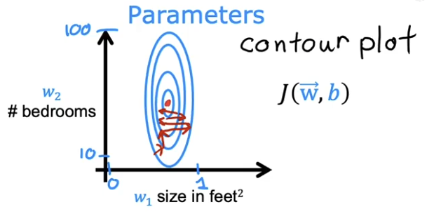
    <figcaption>代价函数</figcaption>
  </figure>

  <figure style="text-align: center;">
    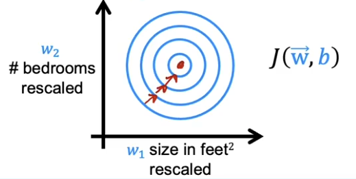
    <figcaption>等高线</figcaption>
  </figure>

</div>

### 3.2.2 如何缩放？

实现缩放的方法有很多，但其核心思想都是比例缩小或放大到一个我们想要的范围内。

1. **归一化Normalization**
    - 顾名思义，直接除。已知 $300 \leq x_{1} \leq 2000$ ，我们想将其限制在 $[0, 1]$ 之间，那我们直接 $\frac{x_{1}}{2000}$ ，就能得到 $0.15 \leq x_{1} \leq 1$。同理， $\frac{x_{2}}{5}$ 就能得到 $0 \leq x_{2} \leq 1$
   
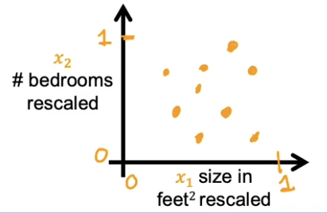
  
2. **均值归一化Mean Normalization**

$$
x_{1} 
=
\frac{x_{1} - \mu_{1}}{2000 - 300} 
$$

$$
\boxed{
  \mu_{1} = x_{1}\text{的均值}
}
$$

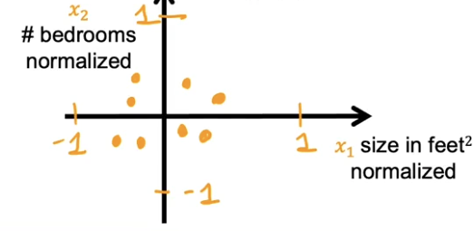

3. **Z-score标准化**

$$
x'=\frac{x-\mu}{\sigma}
$$

$$
\mu = \text{这个特征的均值}
$$

$$
\sigma = \text{这个特征的标准差}
$$

$$
x' = \text{标准化之后的特征值}
$$

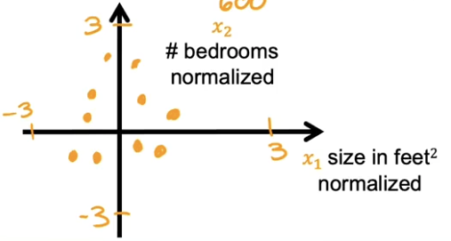

---

## 3.3 学习率

以迭代次数作为横轴、cost作为纵轴，我们能看到，随着迭代次数的增加，我们的cost在越来越小，最终趋向于稳定，这就是学习率适合/没有bug时，会出现的正常图像：

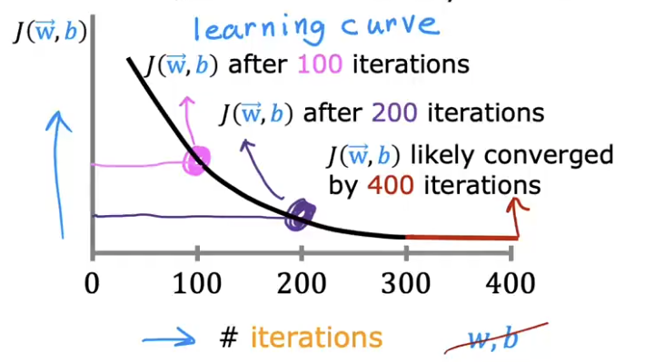

一般来讲，我们都可以尝试一系列的学习率，然后绘制这样的图像，直到找到一个合适的学习率

---

## 3.4 多项式回归

### 3.4.1 特征工程

即**通过现有特征，组合出新特征**。
例如，我们现在有**房子的宽度** $x_{1}$ ，还知道**房子距离街道的深度** $x_{2}$ ，我们可以构造出一个：

$$
f_{\vec{w}, b}(\vec{x}) = w_{1}x_{1} + w_{2}x_{2} + b
$$

的模型。
除此之外，我们还可以构造出一个重要的特征：**房子的占地面积** $x_{3} = x_{1}x_{2}$ 。于是，原模型就可以变成：

$$
f_{\vec{w}, b}(\vec{x}) = w_{1}x_{1} + w_{2}x_{2} + w_{3}x_{3} + b
$$

### 3.4.2 多项式回归

一般而言，我们的训练集数据不太可以完美的契合一个线性回归模型，更多时候，我们需要使用一些曲线来大乘更好的拟合效果，如下图所示：

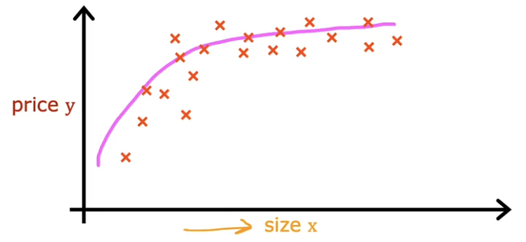

显然一个曲线的拟合效果会比一个直线更好，所以我们需要相应的**创造出一些新的特征值**，使得整体变成一个曲线。
从直觉上来讲，这个图像比较符合一个 $\sqrt{x}$ 函数的特征，所以我们可以尝试构造出这样一个预测模型：

$$
f_{\vec{w}, b}(\vec{x}) = w_{1}x_{1} + w_{2}\sqrt{x_{1}} + b
$$

这其实也是一种**特征工程**，因为我们实际上是用原有的 $x_{1}$ 构造出了一个新的特征 $x_{2} = \sqrt{x_{1}}$

---

## 3.5 分类

### 3.5.1 线性回归模型为什么效果差？

当我们在使用线性回归模型预测分类问题时，会遇到一个问题。当训练集的数据合适时，我们可以通过**常规一元线性回归模型** + 一个**阈值threshold**来做预测：

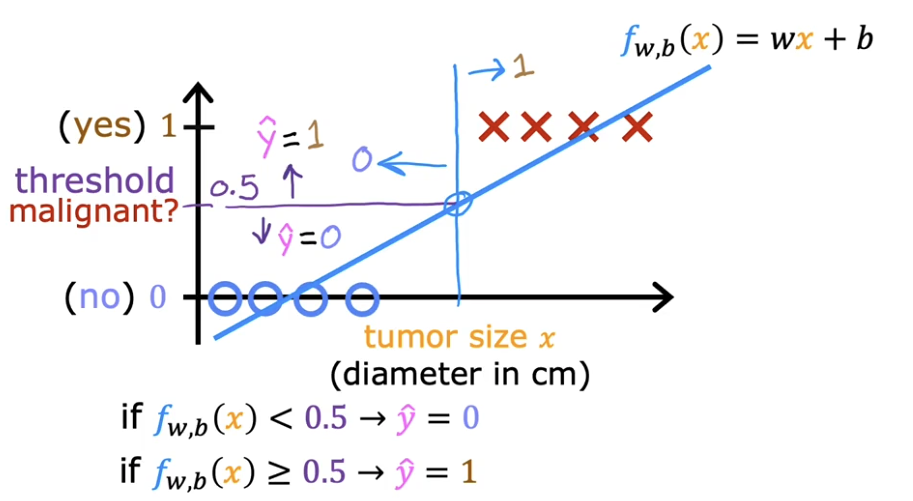

用更简洁的式子表示就是这样：

$$
f_{\vec{w},b}(\vec{x})=
\begin{cases}
0,&f_{\vec{w},b}(\vec{x})<0.5\\
1,&f_{\vec{w},b}(\vec{x})\ge0.5
\end{cases}
$$

但这样又会遇到一个问题，即假设数据集没有那么理想，我们的一元线性回归模型就会偏的离谱：

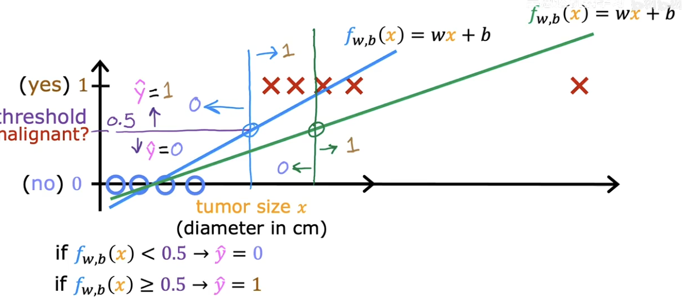

可以看到，我们在右侧加了一个 $(x_{\text{very large}},1)$ ，为了使得cost，也就是 $J(\vec{w}, b)$ 尽可能小，我们的得到了一组新的 $(\vec{w}^{*}, b^*)$ ，这也使得我们的 $f_{\vec{w}, b}(\vec{x})$ 向右偏移，原先的 $\text{threshole}$ 直接就失效了。
当然，我们也可以通过下移这个 $\text{threshold}$ 来解决这个问题，但终究治标不治本，因为这样我们每次新增一个数据，就要修改一次，这十分麻烦。  

### 3.5.2 逻辑回归

为了解决上述问题，我们引入了**逻辑回归**
> 虽然还叫**XX回归**，但是实际上解决的不是**回归问题**，是**分类问题**

很显然，就像之前**多项式回归**里我们遇到的问题一样，这个数据集显然不是线性模型可以解决的，我们需要引入曲线。而从直觉上讲，我们需要的应该是一个形如下图的S形曲线：

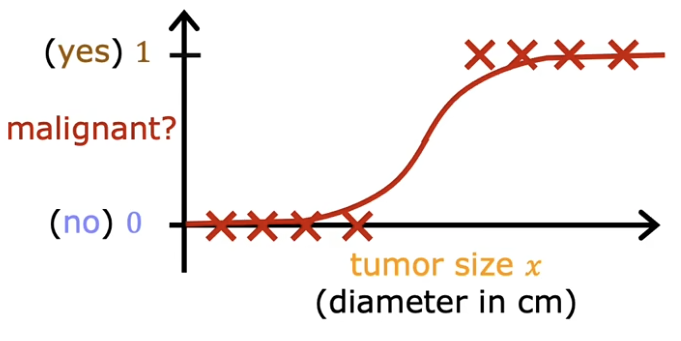

那有没有这么一个S形函数呢？有，**sigmoid函数/logistic函数**：

$$
g(z)=\frac{1}{1+e^{-z}}
$$

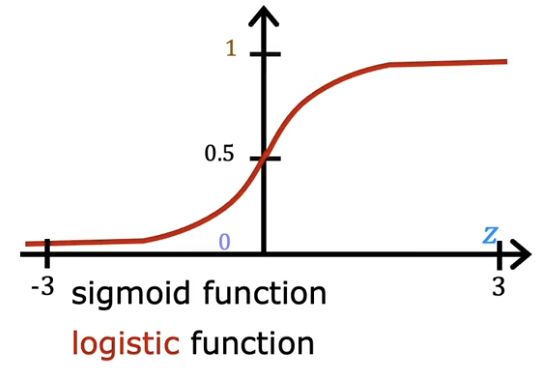

于是一个简单的逻辑回归模型就完成了：

$$
f_{\vec{w}, b}(\vec{x}) = g(z)
$$

其中：

$$
z = \vec{w}\vec{x} + b
$$

即：

$$
f_{\vec{w}, b}(\vec{x}) = g(\vec{w}\vec{x} + b) = \frac{1}{1+e^{-(\vec{w}\vec{x} + b)}}
$$

此时，我们的模型输出就不再是一个具有具体意义的值，而是一个**概率**
例如：
- $x = \text{tumor size}$
- $y = 0(\text{not malignant}) \text{or} 1(\text{malignant})$

则 $f_{w, b}(x) = 0.7$ 的含义就是，该肿瘤是恶性肿瘤的**概率**是70%，即可以写成：

$$
P(y = 1) = f_{w, b}(x)
$$

或者更规范的写法是一个条件概率：

$$
P(y = 1 | \vec{x}; \vec{w}, b) = f_{\vec{w}, b}(\vec{x})
$$

即表示在已知 $\vec{x}$ 的前提下， $y = 1$ 的概率是多少。其中分号 $;$ 后的 $\vec{w}, b$ 表示该结果受这两个参数的影响

而由于 $P(y = 1) + P(y = 0) = 1$ ，因此是非恶性肿瘤的可能性仍然有30%

### 3.5.3 决策边界

当我们使用 $f_{\vec{w}, b}(\vec{x})$ 得出概率后，我们会发现， $y = 0.5$ 是一个中立边界，而这个边界我们就叫**决策边界**。

对于一个 $g(z)$ 来说，$g(z) = 0.5$ 就是他的决策边界，而对应到 $z = \vec{w}\vec{x} + b$ 来说，就是 $\vec{w}\vec{x} + b = 0$ 

例如，我们此时得到了：

$$
w_{1} = w_{2} = 1
$$

$$
b = -3
$$

即：

$$
z = x_{1} + x_{2} - 3
$$

那我们就能画出其**决策边界**：

$$
x_{1} + x_{2} = 3
$$

<p align="center">
  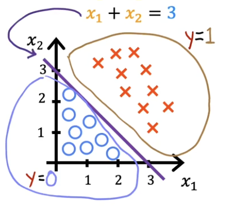<br>
  图3.5.1 线性决策边界
</p>

当然，对于多项式我们也能用此方法求出**非线性决策边界**：

<p align="center">
  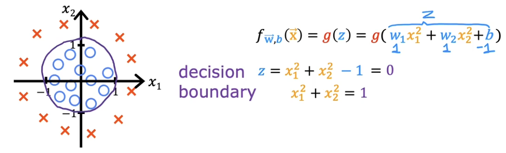<br>
  图3.5.2 非线性决策边界
</p>

<p align="center">
  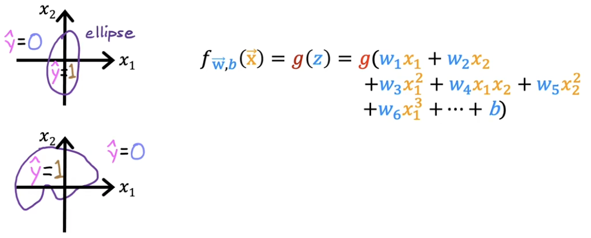<br>
  图3.5.3 更复杂的决策边界
</p>

### 3.5.4 逻辑回归的代价函数

在回归问题中，我们的**线性回归模型**的代价函数很奏效：

<p align="center">
  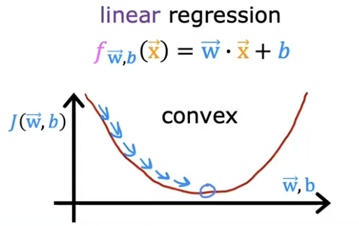<br>
  图3.5.4
</p>

但是一旦我们换成了**逻辑回归**，就会变成这样：

<p align="center">
  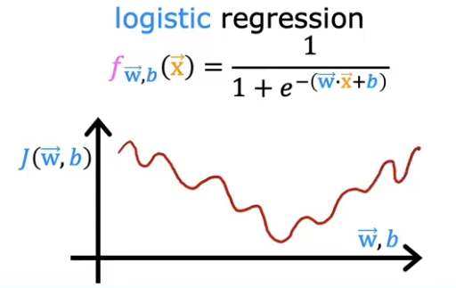<br>
  图3.5.4
</p>

可以看到，如果我们对这个cost function使用梯度下降，很容易进入到局部最小值，而非全局最优。而出现这种问题的原因，就是后面的**损失项**在这里不再适用了，所以我们引入了一种新的损失计算方式：

$$
L(f_{\vec{w}, b}(\vec{x}^{(i)}), y^{(i)})
=
\begin{cases}
  -\log(f_{\vec{w}, b}(\vec{x}^{(i)})), &y^{(i)} = 1\\
  -\log(1 - f_{\vec{w}, b}(\vec{x}^{(i)})), &y^{(i)} = 0
\end{cases}
$$

由于我们的 $f_{\vec{w}, b}(\vec{x}) = g(z)$ ，而逻辑回归模型的取值范围在 $(0, 1)$ ，也就是说，当我们的**真实值** $y^{(i)} = 1$ 时， $f_{\vec{w}, b}(\vec{x})$ 的输出越逼近1，误差函数 $L$ 的值也就越小，相反则越大，这就正好符合我们对误差的希望：

<p align="center">
  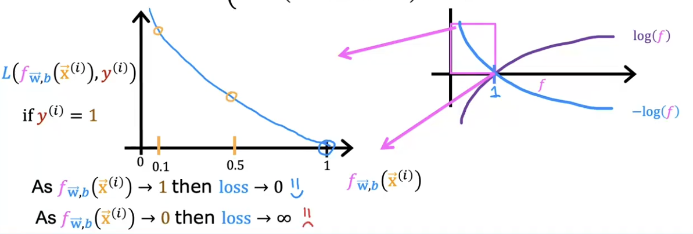<br>
  图3.5.5
</p>

<p align="center">
  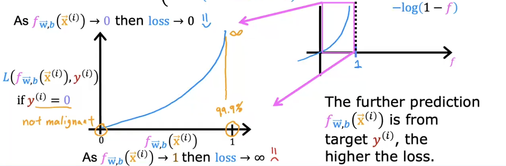<br>
  图3.5.6
</p>

所以我们最终的cost function如下：

$$
J(\vec{w}, b) 
= 
\frac{1}{m} 
\sum_{i=1}^{m}
[L(f_{\vec{w}, b}(\vec{x}^{(i)}), y^{(i)})]
$$

其中：

$$
L(f_{\vec{w}, b}(\vec{x}^{(i)}), y^{(i)})
=
\begin{cases}
  -\log(f_{\vec{w}, b}(\vec{x}^{(i)})), &y^{(i)} = 1\\
  -\log(1 - f_{\vec{w}, b}(\vec{x}^{(i)})), &y^{(i)} = 0
\end{cases}
$$

当然，我们也能更简化写成一行式子：

$$
L(f_{\vec{w}, b}(\vec{x}^{(i)}), y^{(i)})
=
-y^{(i)}\log(f_{\vec{w}, b}(\vec{x}^{(i)}))
-(1 - y^{(i)})\log(1 - f_{\vec{w}, b}(\vec{x}^{(i)}))
$$

通过 $y^{(i)}$ 和 $(1 - y^{(i)})$ 作为原先的条件，控制损失函数

于是展开就能得到：

$$
J(\vec{w}, b) 
=
\frac{1}{m} 
\sum_{i=1}^{m}
[
  -y^{(i)}\log(f_{\vec{w}, b}(\vec{x}^{(i)}))
  -(1 - y^{(i)})\log(1 - f_{\vec{w}, b}(\vec{x}^{(i)}))
]
$$

---

## 3.6 拟合

### 3.6.1 术语

对于**回归问题**，我们的模型可能会表现出三种可能的性质：
- **欠拟合Underfit/高偏差High Bias**：模型拟合效果差
- **泛化Generalization**：拟合效果好，且对于未知数据有较好的预测正确率
- **过拟合Overfit/高方差High Variance**：完美拟合，但是对于未知数据预测效果极差

<p align="center">
  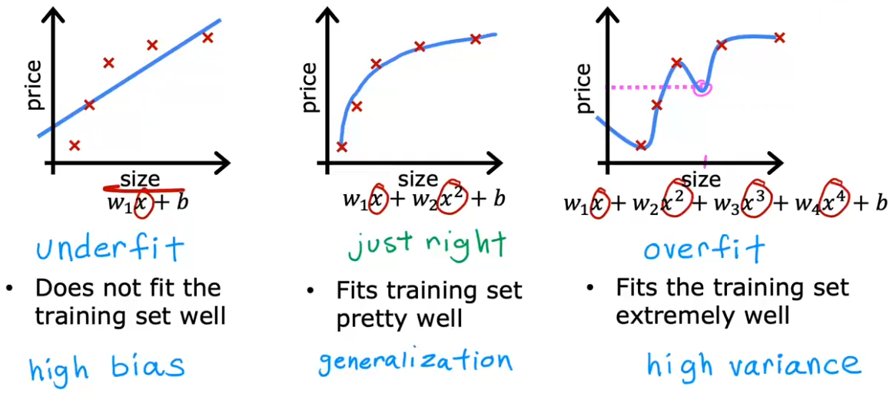<br>
  图3.6.1
</p>

当然，我们的**决策边界**也可能遇到这样的问题：

<p align="center">
  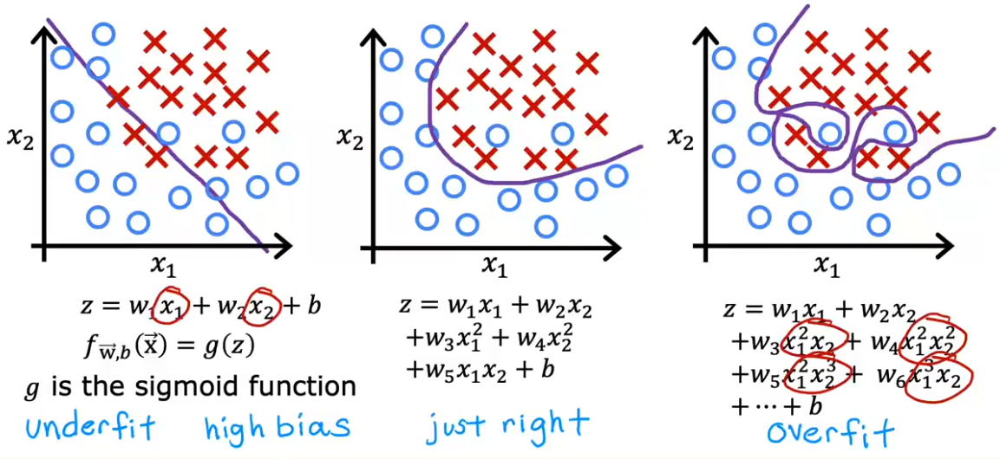<br>
  图3.6.2
</p>

### 3.6.2 解决过拟合

为什么过拟合是我们不想看见的？因为他虽然对于现有数据集有着近乎完美的拟合效果，但是对于陌生数据的泛化能力差的不行。我们几乎无法使用过拟合的模型去做任何有用的预测。

因此，我们有一下三种去解决过拟合问题的方案：

1. **增加训练集样本数**

这个其实比较容易理解，当样本数较少时，数据的规律不太能看的出来，于是拟合的曲线就可能歪歪扭扭的。而当我们增加了样本数，规律就很明显了，于是拟合的曲线也就具有更好的泛化能力

<p align="center">
  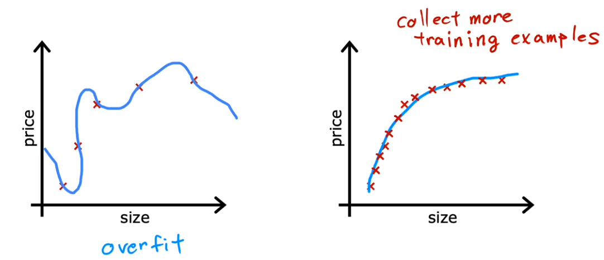<br>
  图3.6.3
</p>

2. **特征选择**

我们的特征集可能会包含很多对最终结果无用的特征，比如“房屋编号”、“房屋照片的数量”等无用信息，他们对于最终房价的预测毫无参考价值，但是算法只认识数据，他不知道这些数字有什么现实含义。如果我们的训练集中，恰好遇到了编号越大的房子房价越高，算法就是拟合出一个偏离现实的模型，造成过拟合。因此，我们需要执行**特征选择**，只留下最有用的那些特征.
但如果遇到了所有特征都有用的情况，那就完蛋🍀了

3. **正则化Regularization**

我们不去除特征，也不增加样本，只需要对每个特征的权重 $w_{j}$ 做调整就行了。例如 $w_{2} = 0$ ，那效果和去除 $x_{2}$ 其实是一样的：

<p align="center">
  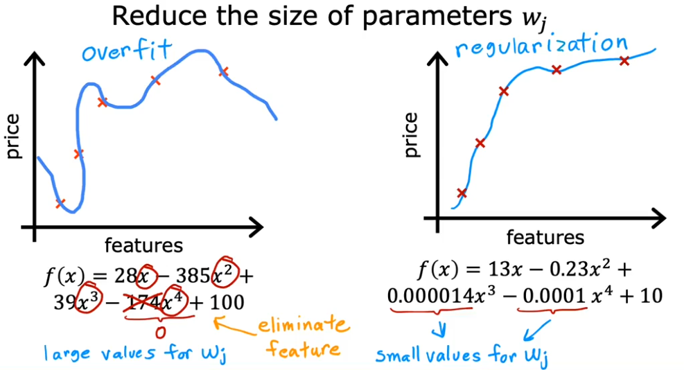<br>
  图3.6.4
</p>

### 3.6.3 正则化的实现

就像我们上面说的那样，**正则化**的本质就是**修改权重** $w_{j}$ ，而这个参数又是由**cost function** $J(\vec{w}, b)$ 算出来的，因此我们需要在它上面下功夫。

回忆一下**cost function**的机制：
利用梯度下降，反复多次尝试不同的 $(\vec{w}, b)$ 组合，直到找到一个最优 $(\vec{w}^{*}, b^{*})$ 使得 $\underset{(\vec{w}^{*}, b^{*})}{\text{minimize}} J(\vec{w}, b)$ 。
而能这么做的原因是， $J(\vec{w}, b)$ 的输出是由未知数 $(\vec{w}, b)$ 所决定的。
因此，只需要我们额外在**cost function**外固定增加特定权重 $w_{j}$ 的影响，最终就能使得该权重的值变小。

例如下式中，我们额外增加一个 $1000w_{3}$ ，这就使得 $w_{3}$ 需要**变得更小**来抵消这部分造成的**cost**

$$
J(\vec{w}, b) 
= 
\frac{1}{2m} \sum_{i=1}^{m}(f_{\vec{w}, b}(\vec{x}^{(i)}) - y^{(i)})^2
+
1000w_{3}
$$

但当特征集过大，或特征集没有无用特征时，我们就很难精准的自己加入一个类似 $1000w_{3}$ 的额外**cost**，于是我们可以直接对所有 $w_{j}$ 施加一个**惩罚**：

$$
J(\vec{w}, b) 
= 
\frac{1}{2m} 
\sum_{i=1}^{m}
(f_{\vec{w}, b}(\vec{x}^{(i)}) - y^{(i)})^2
+
\frac{\lambda}{2m}
\sum_{j=1}^{n}
w_{j}^2
$$

其中 $\lambda > 0$ 且被称为 **正则化参数**。而 $b$ 项对于最终曲线的影响其实不大，所以此处不考虑对 $b$ 也施加**惩罚**。

于是，参数的更新公式也就变成了：

$$
\begin{bmatrix}
  \vec{w}\\
  b
\end{bmatrix}
=
\begin{bmatrix}
  \vec{w}\\
  b
\end{bmatrix}
-
\alpha
\nabla
J(\vec{w}, b)

\\[5pt]

\begin{bmatrix}
  \vec{w}\\
  b
\end{bmatrix}
=
\begin{bmatrix}
  \vec{w}\\
  b
\end{bmatrix}
-
\alpha
\begin{bmatrix}
  \nabla_{\vec{w}}J\\[3pt]
  \dfrac{\partial J}{\partial b}
\end{bmatrix}

\\[5pt]

\begin{bmatrix}
  w_{1}\\
  w_{2}\\
  \vdots\\
  w_{n}\\
  b
\end{bmatrix}
=
\begin{bmatrix}
  w_{1}\\
  w_{2}\\
  \vdots\\
  w_{n}\\
  b
\end{bmatrix}
-
\alpha
\begin{bmatrix}
  \frac{1}{m} 
  \sum_{i=1}^{m}
  (f_{\vec{w}, b}(\vec{x}^{(i)}) - y^{(i)})
  +
  \frac{\lambda}{m}
  w_{1}\\[5pt]
  \frac{1}{m} 
  \sum_{i=1}^{m}
  (f_{\vec{w}, b}(\vec{x}^{(i)}) - y^{(i)})
  +
  \frac{\lambda}{m}
  w_{2}\\[5pt]
  \vdots\\
  \frac{1}{m} 
  \sum_{i=1}^{m}
  (f_{\vec{w}, b}(\vec{x}^{(i)}) - y^{(i)})
  +
  \frac{\lambda}{m}
  w_{n}\\[5pt]
  \frac{1}{m} 
  \sum_{i=1}^{m}
  (f_{\vec{w}, b}(\vec{x}^{(i)}) - y^{(i)})
\end{bmatrix}
$$

但这也会出现一个新的问题。由于我们对所有的权重都施加了惩罚，所以当 $\lambda$ 过大时，所有的 $w_{j}$ 都会过小，导致最终的模型取向一条 $f_{\vec{w}, b}(\vec{x}) = b$ 的直线，出现**欠拟合**的情况。而当 $\lambda$ 过小，则对 $w_{j}$ 来说惩罚无关痛痒，因此还是会导致**过拟合**。

### 3.6.4 逻辑回归的正则化

和上面相似：

$$
J(\vec{w}, b) 
=
\frac{1}{m} 
\sum_{i=1}^{m}
[
  -y^{(i)}\log(f_{\vec{w}, b}(\vec{x}^{(i)}))
  -(1 - y^{(i)})\log(1 - f_{\vec{w}, b}(\vec{x}^{(i)}))
]
+
\frac{\lambda}{2m}
\sum_{j=1}^{n}
w_{j}^2
$$

---
---
---

# 四、神经网络

## 4.1 神经网络的结构与术语

神经网络可以被分为三大块：**输入层**、**隐藏层**和**输出层**

<p align="center">
  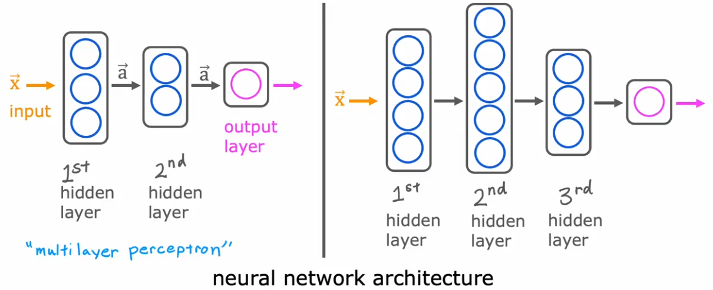
</p>

**输入层**为所有的特征，我们将其打包成一个**输入向量** $\vec{x}$ 传入中间的**隐藏层**。经由各个**神经元neuron**处理后输出成一个**激活向量** $\vec{a}$ 传给**输出层**，最后由输出层的neuron输出最终的结果。

举个例子：

<p align="center">
  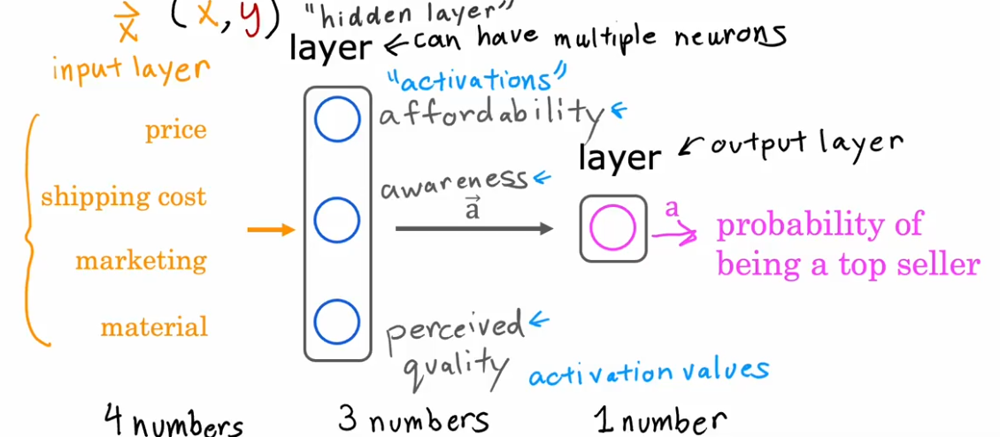
</p>

其中输入向量为：

$$
\vec x=
\begin{bmatrix}
\text{price}\\
\text{shipping cost}\\
\text{marketing}\\
\text{material}
\end{bmatrix}
$$

第一个**隐藏层**有3个neuron。在其中第 $j$ 个neuron上实际计算出：

$$
z_{j}
=
\vec{w} \cdot \vec{x} + b_{j}
$$

然后再经过**激活函数**：

$$
a_{j} = g(z_{j})
$$

最终三个神经元输出：

$$
\vec{a}^{[1]}
=
\begin{bmatrix}
  a_{1}\\
  a_{2}\\
  a_{3}
\end{bmatrix}
$$

其中 $\vec{a}$ 的上标 $^{[1]}$ 表示是**第1层的输出**(输入层为第0层)，之后的每一层就变成了：

$$
z_{j}^{[i]}
=
\vec{w} \cdot \vec{a}^{[i]} + b_{j}
$$

这种

$$
\boxed{\text{输入层} \rightarrow \text{隐藏层} \rightarrow \text{输出层}}
$$

的计算，被叫做**前向推理forward propagation**

---

## 4.2 TensorFlow

---

## 4.3 向量化

我们之前一直都是对于单个neuron讨论，但其实我们可以把一层中所有的neuron合成一个向量表达式。
以之前那个情景为例：

我们的隐藏层的所有**权重参数** $w$ 可以被写成一整个大矩阵：

$$
W_{1}^{[1]}
=
\begin{bmatrix}
  w_{11}^{[1]} & w_{12}^{[1]} & w_{13}^{[1]}\\[5pt]
  w_{21}^{[1]} & w_{22}^{[1]} & w_{23}^{[1]}\\[5pt]
  w_{31}^{[1]} & w_{32}^{[1]} & w_{33}^{[1]}\\[5pt]
  w_{41}^{[1]} & w_{42}^{[1]} & w_{43}^{[1]}
\end{bmatrix}
$$

其中 $w_{ij}^{[n]}$ 表示第 $n$ 层，第 $j$ 个神经元的第 $i$ 个权重参数，即**每一列代表一个神经元，一行代表一个特征分量**：

$$
W_{1}^{[1]}
=
\begin{bmatrix}
  \uparrow & \uparrow & \uparrow\\
  \vec w_1 & \vec w_2 & \vec{w_{3}}\\
  \downarrow & \downarrow & \downarrow
\end{bmatrix}
$$

而**Bias偏差参数** $b$ 也能表示成：

$$
B_{1}^{[1]}
=
\begin{bmatrix}
  b_{1}^{[1]} & 
  b_{2}^{[2]} &
  b_{3}^{[3]}
\end{bmatrix}
$$

结合我们之前的**输入向量**：

$$
\vec x=
\begin{bmatrix}
  x_{1}\\
  x_{2}\\
  x_{3}\\
  x_{4}
\end{bmatrix}
$$

我们就能写出

$$
Z^{[1]}
=
\vec{x}^{T}
W_{1}^{[1]}
+
B_{1}^{[1]}

\\[5pt]

\vec{a}^{[1]} = g(Z^{[1]})
$$

在有多个隐藏层的情况下， $\vec{x}$ 可以还可以是 $\vec{a}^{[n-1]}$ 表示前一个隐藏层输出的 $\text{Activation}$ 向量

---

## 4.4 激活函数

### 4.4.1 Sigmoid

适用于**二分类问题**的**输出层**

### 4.4.2 ReLU

矫正线性单元Rectified Linear Unit
适用于 $y$ 为**非负数**的回归问题的**输出层**
同时也是最常见的**隐藏层**激活函数

$$
g(z) = \max(0, z)
$$

### 4.4.3 线性激活函数

适用于 $y$ 可取正或负的**线性回归问题**的**输出层**

$$
g(z) = z
$$

---

## 4.4 多分类问题

<p align="center">
  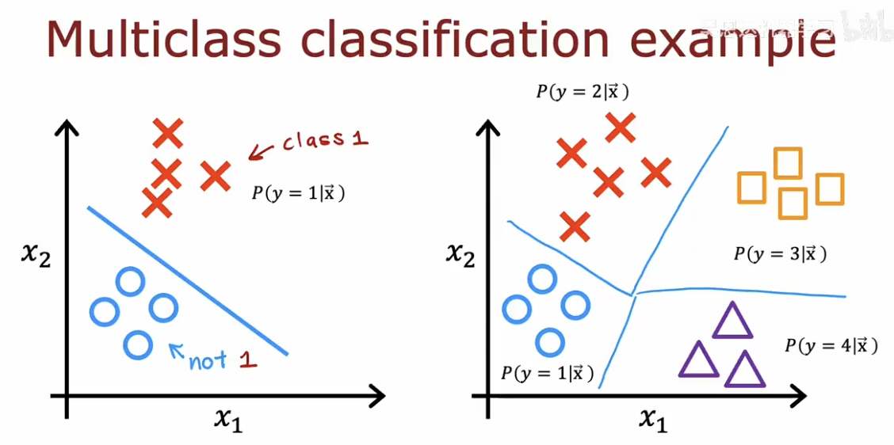
</p>

### 4.4.1 Softmax回归算法

sigmoid的扩展

<p align="center">
  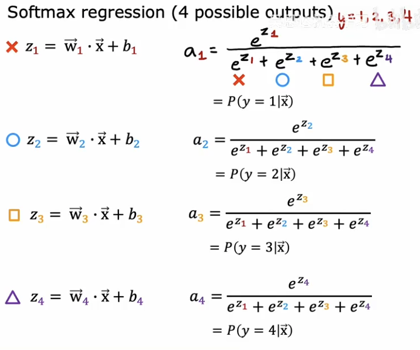
</p>

所以对于有 $n$ 种类别的分类问题，softmax函数就是：

$$
a_{i}
=
g(z_{i})
=
\frac{e^{z_{i}}}{\sum_{j=1}^{n}e^{z_{j}}}
=
P(y = i | \vec{x})
$$

其中：

$$
z_{i} = \vec{w}_{i} \cdot \vec{x} + b_{i}
$$

其**损失函数**为：

$$
loss(a_{1}, \dots, a_{n}, y)
=
\begin{cases}
  -\log a_{1} &,y = 1\\
  -\log a_{2} &,y = 2\\
  &\vdots\\
  -\log a_{n} &,y = n\\
\end{cases}
$$

<p align="center">
  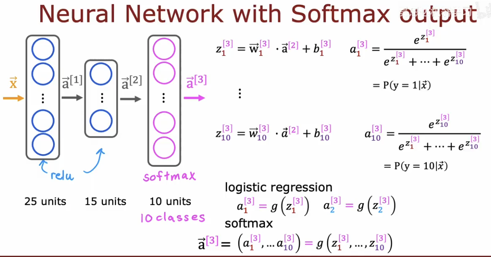
</p>

### 4.4.2 多标签问题

和多分类问题不同，多标签问题的构成是**多个二分类问题**，所以我们一般会用多个sigmoid函数作为输出层，而不是用softmax

---

## 4.5 高级优化方法

### 4.5.1 Adam

Adam全称Adaptive Moment estimation，自适应动量估计。可用于**自动调节学习率** $\alpha$ 的大小。
但要注意的是，不像我们之前简化的 $\alpha \nabla J$ 一样，Adam需要我们为每个参数设置独立的学习率 $\alpha_{i}$ 。例如，假设有 $w_{1}, \dots, w_{10}, b$ 这11个参数，则Adam会独立的去调整 $\alpha_{1}, \dots, \alpha_{10}, \alpha_{11}$ 的大小。

Adam的直观理解是，如果 $w_{j}$ 或 $b$ 大致保持向同一个方向移动，则增大 $\alpha_{j}$ 使其跑的更快；如果 $w_{j}$ 或 $b$ 的方向来回振荡，则降低 $\alpha_{j}$ 来减缓振荡

---

## 4.6 其他类型的神经网络层

### 4.6.1 密集层Dense Layer

我们之前一直都在使用的layer叫做**Dense Layer**，其中**每个层的每个神经元都将前一层的所有激活作为输入**

### 4.6.2 卷积层Convolutional Layer

每一层的每个神经元都只将前一层的**一部分**激活作为输入，各神经元之间的输入可能会有重复

<p align="center">
  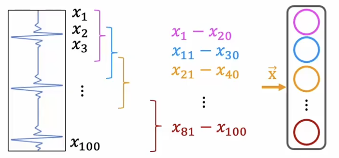
</p>

---

## 4.7 模型评估

### 4.7.1 交叉验证集合CV

我们一般会将一个**样本集**分割成三个部分：**train集**、**CV集**和**test集**

其中**train集**用来**训练模型**、**CV集**用来从训练好的集合中，通过计算其 $J$ 输出(不包含正则项)，**筛选出泛化能力最好的model**，最后**test集**会再算一次 $J$ 用于**误差报告**

### 4.7.2 Bias/Variance

我们之前讲过，欠拟合和过拟合有个别称，就是**high bias**和**high variance**，那我们可以通过 $J_{train}$ 和 $J_{cv}$ 来用数值判断：

<p align="center">
  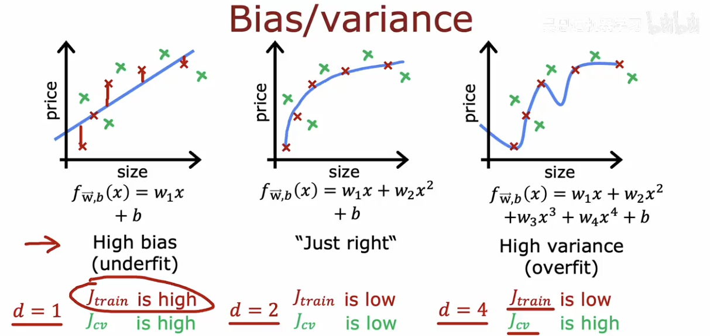
</p>

$J_{train}$ 和 $J_{cv}$ 随多项式**degree**的增长而变化的图像：

<p align="center">
  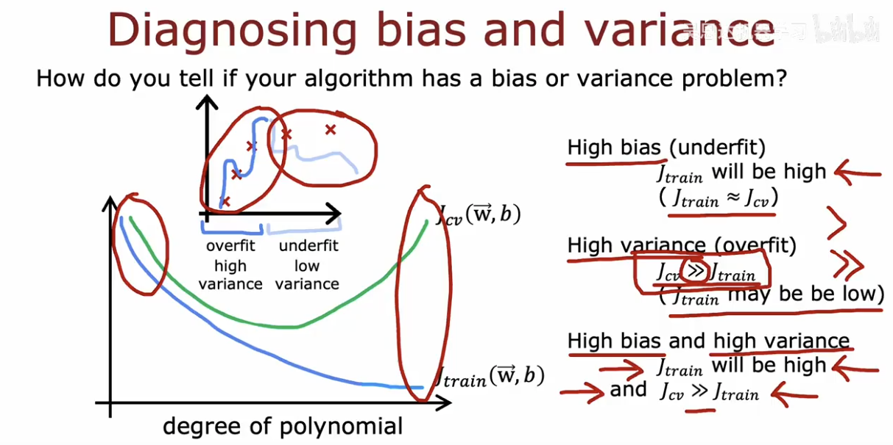
</p>

### 4.7.3 Lambda

<p align="center">
  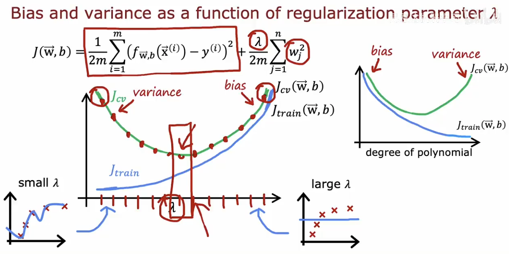
</p>

### 4.7.3 Benchmark

对于**bias**和**variance**的大小判断，我们需要设置一个基准线来作为判断条件

假设一个语音识别场景，我们得到了 $J_{train} = 10.8%$ 和 $J_{cv} = 14.8%$ 的成绩。第一眼看上去似乎这个 $J_{train}$ 很高，而 $J_{train}$ 和 $J_{cv}$ 的差距感觉没有那么大，因此可能会判断是一个**欠拟合/high bias**问题。

但如果我们加入一个**人类表现水平** $J_{human} = 10.6%$ ，就会发现，实际上模型的表现和人类的水平相差不大，其效果实际上很好，所以不会是一个**欠拟合/high bias**问题，那么相对而言，就可能是一个**过拟合/high variance**问题，也就是说可能 $d$ 过大了或者是 $\lambda$ 过小了，我们就可以依次来去调整我们模型的这些**超参数**

### 4.7.4 学习曲线

<p align="center">
  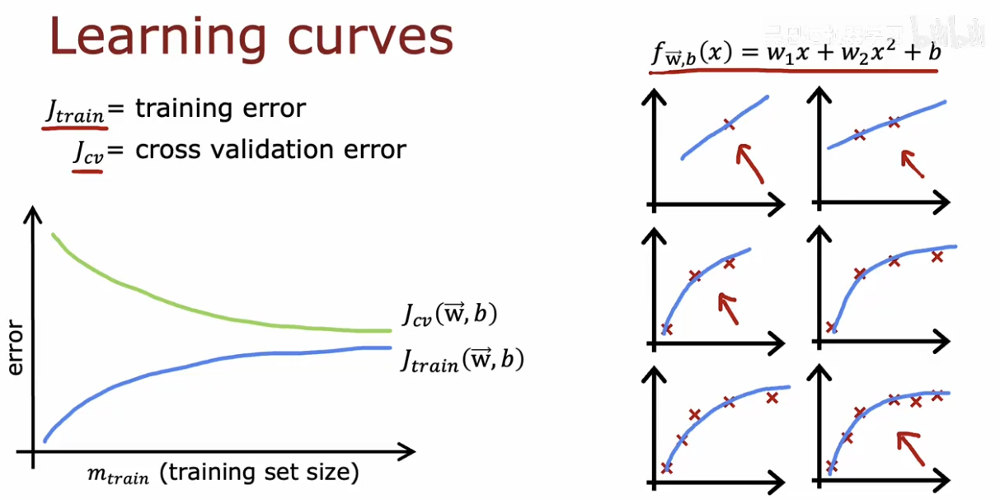
</p>

<p align="center">
  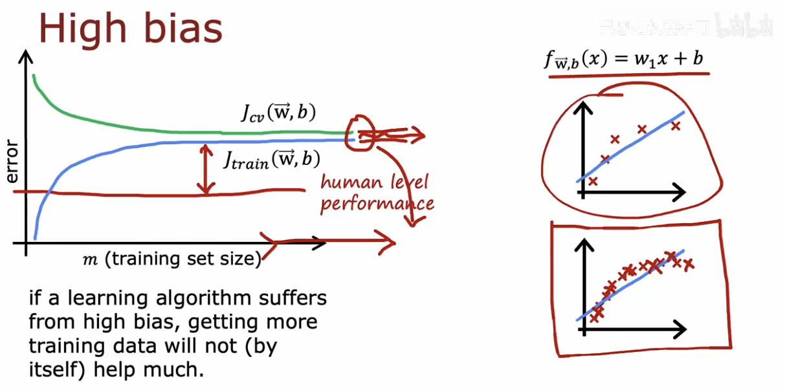
</p>

<p align="center">
  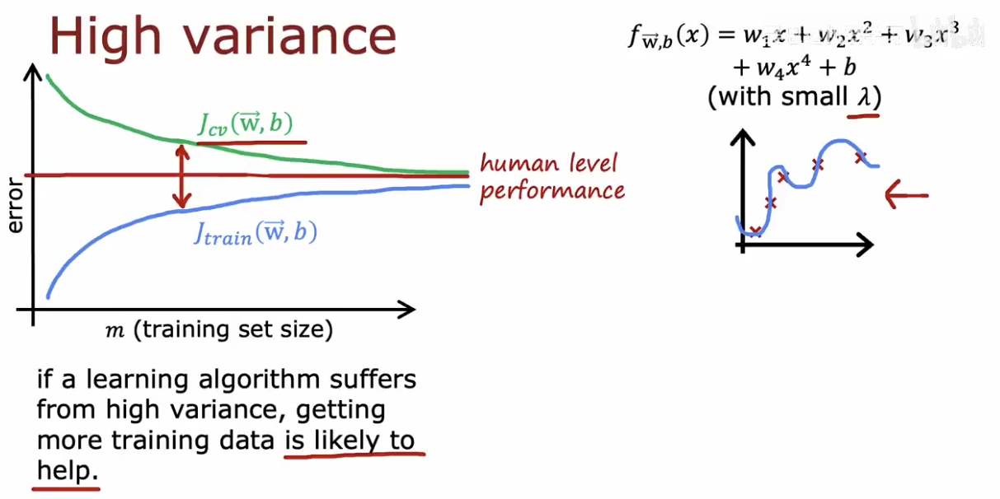
</p>

### 4.7.5 bias variance balance

<p align="center">
  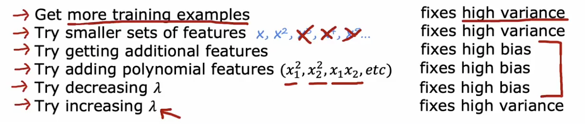
</p>


<p align="center">
  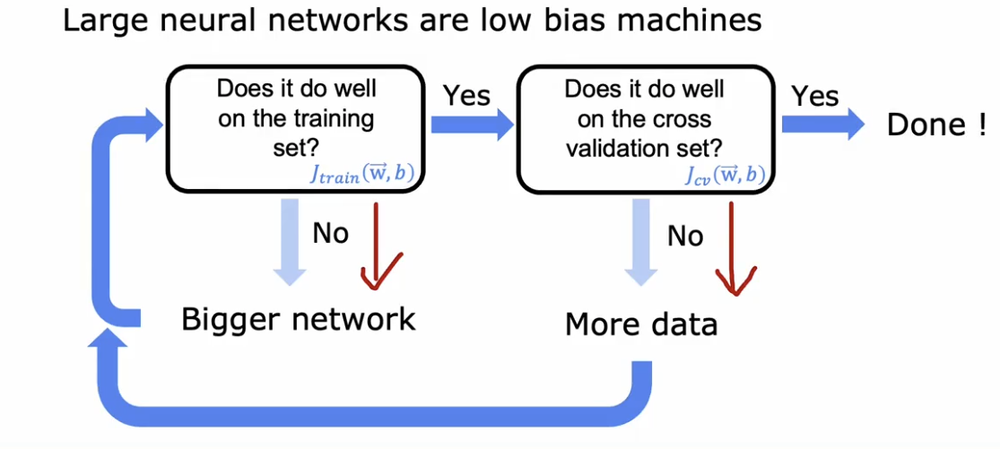
</p>

---

## 4.8 机器学习的开发过程

<p align="center">
  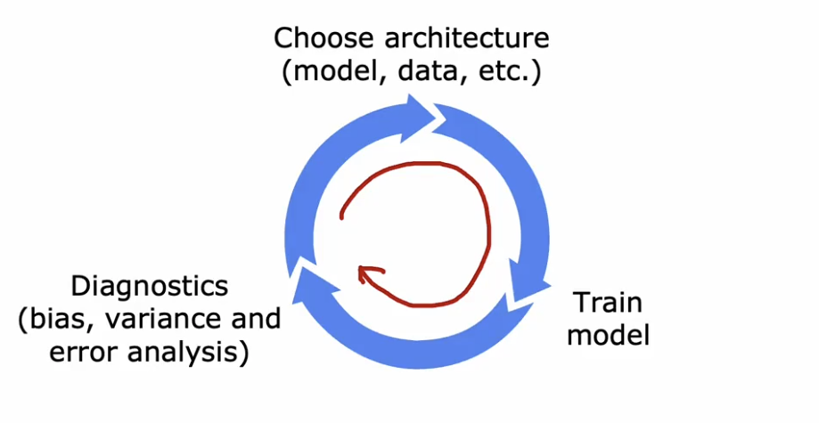
</p>

### 4.8.1 误差分析

如果错误较少，我们可以尝试**归因**，将误差样本依据**错误原因**分类成不同的集合，然后有就能优先去处理最大的问题，

如果错误过多。我们可以使用**抽样调查**的方法，抽取其中一部分，再来**归因**

### 4.8.2 增加数据

总之就是补充我们需要的数据，面多了加水，水多了加面

### 4.8.3 迁移学习Transfer Learning

说白了就是直接把别人类似的模型偷过来。我想做一个手写数字的识别，但我没那么多数据量训练，咋办？直接把别人训练好的比如说识别cats, dogs, cars等等输出的视觉识别模型的隐藏层缝到我们自己的项目上，参数别人已经训练好了，我们只需要改一下输入层和输出层就行了，输入就是我们自己的输入，输出改称10个输出单元，对应0 ~ 9的数字，然后我们就能从人家训练好的参数作为起点开始训练，真正从0开始训练的只有输出层的参数。

讲得专业一点，前面在**大型数据集**上训练网络的步骤叫做**监督预训练Supervised Pretraining**，后面把人家那个隐藏层缝过来后，我们以其为基础再来训练的步骤叫做**微调Fine Tuning**

---

## 4.9 倾斜数据集的误差指标

在某些情况下，我们的数据集是一个**有倾斜的**数据集，即该数据集中，不同类别的占比完全失衡。
例如，我们想要训练一个模型来检测一种**罕见病例**，假设 $y = 1$ 表示该**罕见病**， $y = 0$ 表示**不是罕见病**，那数据集中的占比可能会出现这种情况：

$$
P(y = 1) = 0.5\% \\
P(y = 0) = 99.5\%
$$

即数据集中的样本，极端**倾斜**某一方，而不是接近**50-50**的平衡。

那这会导致什么问题呢？也就是 $J$ 的失效。
数据集中样本的极端倾斜，也会导致**训练集**中的样本严重**倾斜**，使得我们的即使最终通过 $J_{cv}$ 的筛选，并且 $J_{test}$ 的误差报告也很低，该模型依旧不值得信任。

因为即使某模型 $J_{test} = 1\%$ ，但这是由于数据的**倾斜**，导致他的分类结果几乎都是 $0$ ，而我们希望的是模型对 $y = 1$ 有着良好的分类正确率，因此我们需要一个全新的指标，来评判模型的性能。

### 4.9.1 准确率Precision和召回率Recall

为了描述**倾斜数据集**的**模型误差指标**，我们引入一种新的评判标准：**准确率**和**召回率**.

其中**Precision**描述的是，**模型对某一类别分类的正确率**，即我预测为正确的里面，有多少真的正确？:

$$
\text{Precision}
=
\frac{\text{对了多少个}}{\text{检测到了多少个}}
$$

而**Recall**描述的则是，**模型对于某一类别的检出率**，即所有真正患者里面，我找出来多少？：

$$
\text{Recall}
=
\frac{\text{检测出了多少个}}{\text{一共有多少个}}
$$

<p align="center">
  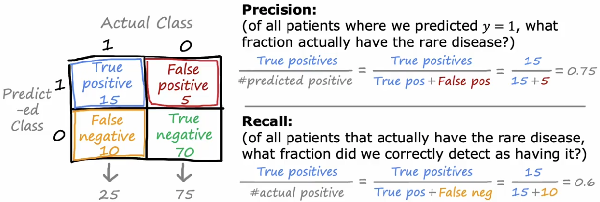
</p>

### 4.9.2 Precision和Recall的权衡

Precision和Recall其实都是由我们的threshold控制的，并且是**此消彼长**的关系

假设我们设置 $f \ge 0.9 \rightarrow \hat{y} = 1$ 也就是说，只有当我们有 $90\%$ 把我的时候，才判定检测出了该罕见疾病。这就会导致我们的**Recall检出率**大大下降，因为我们抛弃了一部分实际上患有该罕见病的人，但是**Precision准确率**却大大上升，因为我们只有在有极其充分把握的前提下才会判定为**患有罕见病**。

反之，如果我们设置 $f \ge 0.3 \rightarrow \hat{y} = 1$ ，也就是说，只要有 $30\%$ 的把握，我们就认定该人可能患有罕见病。这使得我们的**Recall**上升，因为这相当于只要有相关症状，我们直接就认定该人患病，所以我们几乎可以检测出所有患病的人。但同时**Precision**也会随之下降，因为我们很可能误症了不少没有患病的人进来。

<p align="center">
  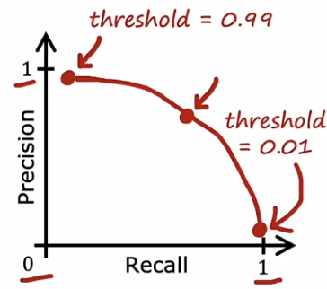
</p>

### 4.9.3 F1 score

**F1 score**可以帮助我们自动权衡**Precision**和**Recall**，帮助我们筛选最好的模型。其计算公式如下：

$$
F_{1}
=
\frac{1}{
  \frac{1}{2}
  (
    \frac{1}{P}
    +
    \frac{1}{R}
  )
}
$$

化简后：

$$
F_{1}
=
2\frac{PR}{P + R}
$$

相当于是一个并联电阻公式 * 2，更学术的叫法是取P和R的**调和平均数Harmonic Mean**

---
---
---

# 五、决策树

## 5.1 简介

### 5.1.1 例子

假设一个哈基米的分类问题。
我们的数据集如下：

<p align="center">
  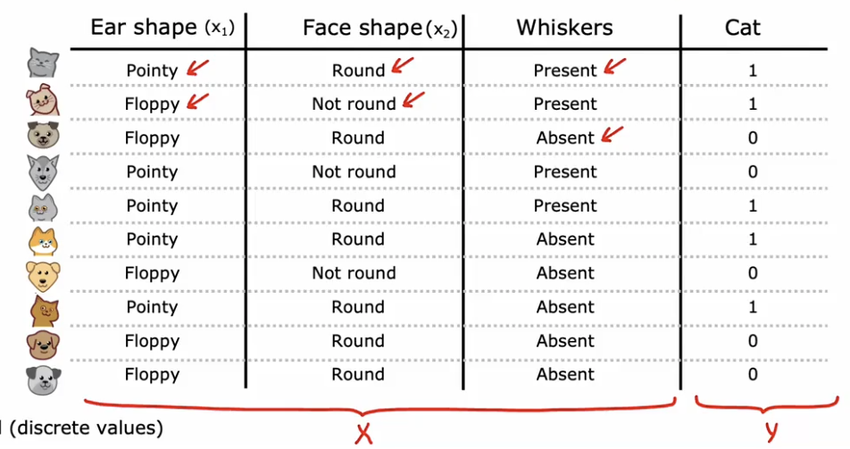
</p>

于是我们能构建出这样一颗树：

<p align="center">
  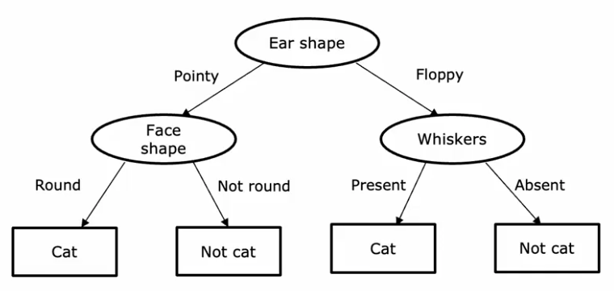
</p>

其中最顶端的节点被称为**root node根节点**，中间的节点被称为**dicision nodes决策节点**，而最底部的节点叫做**leaf nodes叶节点**。

当然我们还可以构建出更多不同的树：

<p align="center">
  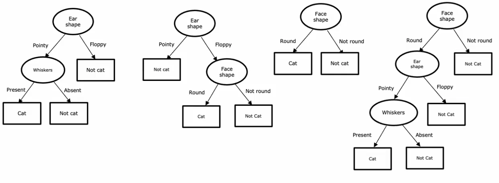
</p>

其中从**root**，到某一任意节点需要的**跳数hops**称为该节点的**深度depth**

---

## 5.2 节点选择

### 5.2.1 熵Entropy

**熵entropy**其实是一个函数 $H(p)$ 的输出，我们用它来描述一个集合的**不纯度/混乱度**，其表达式为：

$$
p_{0} + p_{1} = 1\\[5pt]
H(p_{1}) = -p_{1}\log_{2}(p_{1}) - p_{0}\log_{2}(p_{0})
$$

很明显，如果对于多种类别来说，我们就能推广到：

$$
\sum_{k=1}^{K}p_k=1\\[5pt]
H(p_1,\dots,p_K)
=
-\sum_{k=1}^{K}p_k\log_2 p_k
$$

其中 $K$ 代表了集合中一共有 $K$ 种类别

接着我们之前那个例子，假设：

$$
(y = 1) \rightarrow \text{Cat}\\[5pt]
(y = 0) \rightarrow \text{Dog}
$$

则我们使用 $p_{1}$ 表示集合中猫的占比，那么该集合的**熵**就是 $H(p_{1})$ ，该函数输出随输入的变化取线大致如下：

<p align="center">
  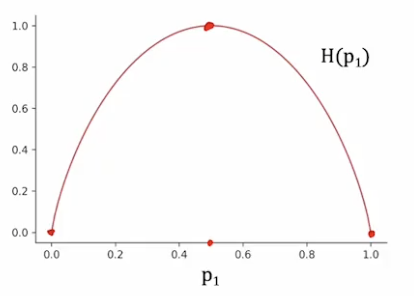
</p>

可以看到，当 $p_{1} = 0.5$ ，即该集合中，猫的占比达到 $50\%$ 时，该集合是**最不纯/混乱的**。
相比之下，当 $p_{1}$ 越接近 $0.0$ 或者 $1.0$ ，该集合的**不纯度/混乱度**越低，即代表了该集合中几乎只有猫或者狗，也就是很**纯净**。

### 5.2.2 信息增益Infomation Gain

当我们需要觉得如何分裂的时候，我们可以使用**信息增益**来衡量：

$$
Gain
=
H(p_{1}^{root}) - [w^{left}H(p_{1}^{left} + w^{right}H(p_{1}^{right}))]
$$

其中权重参数指的是**分裂出的单个子集**元素数占**原集合**的比例
很明显，这个式子说白了就是**上一个节点的熵** $-$ **分支熵的加权平均**，以此来衡量选择不同特征作为分支，对于**纯度**的增量，而我们就是要选择增量最大的特征，因为以它作为分支，我们可以获得更纯的两个子集，也就对于最终分类的结果更进一步。

<p align="center">
  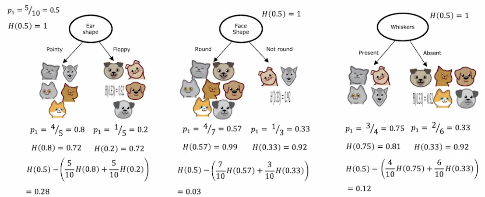
</p>

### 5.2.3 独热编码one-hot encoding

为了简化和引入，我们上面的例子中，每个特征都只有二元的选择，但是实际中，更多的是同个特征拥有多个可能，那么除了直接从一个节点分裂出多个分支以外，我们还有一种特别的方式，能够实现**多元转二元**，那就是**one-hot encoding**。

简单的说，**one-hot encoding**就是**将类别作为一种特征**，以此实现了二元转换。

接着上面的例子，我们之前的**Ear shape**特征中只有**Pointy尖耳**和**Floppy垂耳**两个类别，假设我们增加一个**Oval椭圆耳**，就变成了一个三元分类问题，也就是：**“这个动物的耳形是尖耳？垂耳？还是椭圆耳？”**

此时，我们可以**将这个一个问题，拆成三个小问题**：**“这个动物的耳形是尖耳吗？”、“这个动物的耳形是垂耳吗？”、“这个动物的耳形是椭圆耳吗？”**。对这三个小问题，我们的回答只有**是或不是**，也就变成了三个二元分类问题。

<p align="center">
  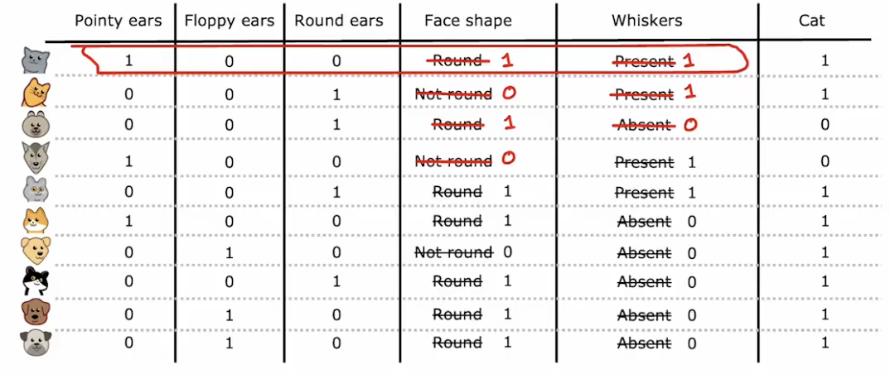
</p>

---

## 5.3 连续值处理

### 5.3.1 连续特征值

当我们遇到连续值时，我们也可以对其进行分割，然后得到一个二元分类结果，也就是设置一个阈值。而对于该阈值的具体数值，我们依然需要根据信息增益来决定：

<p align="center">
  
</p>

### 5.3.2 回归树

我们需要对之前的**信息增益**算法做一个小更改，即将**熵**换成**方差**，而我们最终的预测结果就是取**叶节点集合的均值**

<p align="center">
  
</p>

<p align="center">
  
</p>

---

## 5.4 树集成tree ensemble

决策树的一个缺点是，**对于数据微小变化及其敏感**：

<p align="center">
  
</p>

如上图所示，我们仅仅是改变了一个样本，整个决策树的结构就要推倒重建。

因此，我们引入了**tree ensemble**，用多个不同的树进行分类并让他们投票，获得票数最多的那个类别就作为最终结果：

<p align="center">
  
</p>

### 5.4.1 有放回抽样Sampling with replacement

**有放回抽样**地抽出m个样本，作为一个**新训练集**

### 5.4.2 随机森林算法Random forest algorithm

其实就是，先规定我们想创建 $B$ 个决策树，然后对于每个决策树，我们**有放回随机抽样**地抽出 $m$ 个样本作为其训练集，也就是一共有 $B$ 个训练集/决策树，构成一个森林。
同时对于特征，我们一般也会只取其中的 $k$ 个特征，而不是将所有 $n$ 个特征都纳入训练集中，这样我们构建出来的森林中的每一颗树都能尽可能的长的不一样，让我们的森林具有更强的鲁棒性。一般来讲， $k = \sqrt{n}$

<p align="center">
  
</p>

### 5.4.3 XGBoost

其实就是换了一种抽样方式。我们前面用的是**有放回的随机抽样**，也就是说，数据集中的每一个样本，其被抽中作为训练集数据的概率是相同的。

而XGBoost则不同。第一颗树，我们仍然采用**sampling with replacement**，而对于第二颗树，XGBoost会提高在前一颗树训练后，分类结果不太好的样本被抽中的概率。也就是说，如果在这颗树中，你被分到了错误的类别中，那你就更有可能继续到下一颗树中再次作为训练集的一部分。

XGBoost的思想其实很简单，就是如果这颗树治不了你，那我就把你单独拿出来训练，直到有一棵树能完美分类你。

~~前面写的好像错了，但我懒得改了。~~

**XGBoost**全称**eXtreme Gradient Boosting极端梯度提升**，这是个库。他实际上不会大量生成随机选择的训练集，而是为不同训练样本分配不同权重

---
---
---

# 六、无监督学习Unsupervised learning

## 6.1 聚类Clustering

### 6.1.1 K-means

k-menas算法的逻辑其实很简单，说白了就是去找各个簇的中心，也就是簇的**质心cluster centroids**。

先初始化随机取两个点，然后计算各个数据与这两个点的距离，之后离谁最近就把这个数据分配给谁，这就形成了第一代簇分配。
如下图中，先随机取了红蓝两个**centroids**，再依据距离远近，分配给两个centroids：

<p align="center">
  
</p>

之后，我们计算这两个簇的均值，并移动controids到均值点处：

<p align="center">
  
</p>

然后就是循环迭代，继续分配、计算均值、移动centroids，直到centroids不再出现较远距离移动或不再移动：

<p align="center">
  
</p>

推广到一般情况，我们会先**随机初始化** $K$ 个**cluster centroids** $\mu_{1}, \mu_{2}, \dots, \mu_{K}$ ，其中各个 $\mu_{k}$ 与数据集维度相同。

之后我们执行分配。先计算出各个数据点 $x^{(i)}$ 与 $\mu_{k}$ 的距离：

$$
\lVert x^{(i)} - \mu_{k} \rVert   
$$

之后，我们会为每个数据集设置一个**索引index** $c^{(i)}$ ，这个**index**的值就表示**该数据属于哪个cluster centroids**：

$$
c^{(i)} = \underset{k}\min{\lVert x^{(i)} - \mu_{k} \rVert}
$$

例如，对于数据 $x^{(12)}$ 假设它距离 $\mu_{2}$ 最近，那我们就令 $c^{(12)} = 2$

<p align="center">
  
</p>

### 6.1.2 k-means的cost function

k-means也有自己的cost funciton，但此处不是用来结合梯度下降来优化参数，而是用来评价当前的聚类是否合理。

开始前先再次规范一下各个参数的意义：

$$
c^{(i)} = \text{样本} x^{(i)} \text{属于第} c \text{个cluster centroid}\\[5pt]
\mu_{k} = \text{第}k\text{个cluster centroids}\\[5pt]
\mu_{c^{(i)}} = \text{样本} x^{(i)} \text{所属的第} c \text{个cluster centroid}
$$

现在我们就能构建出如下**cost function**：

$$
J(c^{(1)}, \dots, c^{(m)}, \mu_{1}, \dots, \mu_{k})
=
\frac{1}{m}
\sum_{i=1}^{m}
\lVert x^{(i)} - \mu_{c^{(i)}} \rVert^{2}
$$

当然，在k-means中，我们不叫**cost function**，我们叫它**失真函数distortion function**。在k-means中，我们的每一步移动都应该保证 $J$ 在下降，而最终 $J$ 越小，我们的cluster centroids位置也就越合理。
同时，它也可以用来判断我们停止迭代的时机。当我们继续移动cluster centroids，而 $J$ 的降低已经微乎其微的时候，就代表着k-means收敛，可以停止迭代了。

### 6.1.3 k-means初始化

比起我们之前的完全随机，更一般的做法是令初始centroids的位置直接为数据集中的某个点。例如初始化 $\mu_{1} = x^{(3)}$ 这样。

但这同样也会导致问题，也就是会出现多个解。因此我们会考虑执行多次k-means，然后比较他们的 $J$ ，最终找到一个 $J$ 最小的clustering方式：

<p align="center">
  
</p>

---

## 6.2 异常检测

### 6.2.1 密度估计Density estimation

学习各个样本在不同区间出现的概率 $p$ ，之后出现新的陌生样本 $x_{new}$ ，如果有 $p(x_{new}) < \epsilon$ 则表示该陌生样本为异常值。

那其实也很简单，就是利用我们万能的**高斯分布**：

$$
\mu 
=
\frac{1}{m}
\sum_{i=1}^{m}
x^{(i)}

\\[5pt]

\sigma^{2}
=
\frac{1}{m}
\sum_{i=1}^{m}
(x^{(i)} - \mu)^{2}
$$

统计学家会告诉你，这里的 $\sigma^2$ 的计算应该除以 $m - 1$ 而不是 $m$ ，但在机器学习语境下，这两个差别不大，所以就用 $m$ 也行。

推广到一般形式，即此时的 $x_{(i)}$ 是个有 $n$ 个分量的向量：

$$
p(\vec{x}^{(i)})
=
p(x_{1}^{(i)};\mu_{1}, \sigma_{1}^{2})
\times
p(x_{2}^{(i)};\mu_{2}, \sigma_{2}^{2})
\times
\dots
\times
p(x_{n}^{(i)};\mu_{n}, \sigma_{n}^{2})

\\[5pt]

p(\vec{x}^{(i)})
=
\prod_{j=1}^{n}
p(x_{j}^{(i)};\mu_{j}, \sigma_{j}^{2})
$$

其中：

$$
p(x_{j}^{(i)};\mu_{j}, \sigma_{j}^{2})
=
\frac{1}{\sqrt{2\pi\sigma_{j}^{2}}}
\exp
\left(
  -\frac{(x_{j}^{(i)} - \mu_{j})^2}{2\sigma_{j}^{2}}
\right) 
$$

### 6.2.2 评估

第一种方式就是沿用之前的**训练集**、**CV集**和**测试集**的分类标准，通过 $J_{cv}$ 来选择合适的 $\epsilon$ 。

还有一种方法就是，我们注意到我们的数据集其实是一个**倾斜**数据集，也就是说**异常**在我们的数据集中占比很少，绝大部分都是**正常**的数据，因为我们需要大量正常的数据，去拟合出一个更好的**高斯分布**。而且我们的目的是去选择一个 $\epsilon$ ，而 $\epsilon$ 在次数本质就是个**阈值**
因此，我们就可以再用我们的**Precision**、**Recall**和**F1-score**来自动选择一个较好的 $\epsilon$

### 6.2.3 特征工程

我们有时会遇到一些不太符合高斯分布的特征，因此我们需要将其转化成符合高斯分布的特征，例如取对数、开根等。

当然有时候我们也需要取组合创造一些新特征，来方便异常检测

<p align="center">
  
</p>

---
---
---

# 七 推荐系统

## 7.1 协同过滤Collaborative filtering algorithm

平时在看视频的时候，视频平台往往会依据我们已经看过的内容，推荐相关内容，我们以电影为例。

一般情况下，我们会想，每个电影都会有它的**标签**，我们看完电影后也会给电影评个0 ~ 5的**星级**，那么我们就可以将**标签**视为**feature**，将**星级**视为**label**，来预测那些电影用户会更喜欢。

但问题是，每个电影的分类实际上并不那么非黑即白，也许这部片子的分类是“喜剧”，但实际上其中也含有部分的“浪漫”、“动作”等等元素。
除此之外，还可能由于不同的元素组合，产生了我们难以用自然语言去描述的新**特征**，这就导致了我们实际上是不清楚，我们的**特征**到底是什么。

因此，我们尝试使用无监督学习，去从数据中学习出一部电影的**特征**。

<p align="center">
  
</p>

如上图所示，我们对于第一个电影，可以通过这四个用户的评分，列出右下角四个方程，从而解除这个 $x^{(1)}$ 的值大致是多少。

现在，我们就能定义出**模型学习第 $i$ 部电影特征**的**cost function**，在给定 $\vec{w}$ 和 $\vec{b}$ 的前提下：

$$
J(x^{(i)})
=
\frac{1}{2}
\sum_{j: r(i, j) = 1}
(w^{(j)}x^{(i)} + b^{(j)} - y^{(i, j)})^{2}
+
\frac{\lambda}{2}
\sum_{k=1}^{n}
(x_{k}^{(i)})^{2}
$$

其中：
$r(i, j)$ 表示第 $j$ 个用户**是否对第 $i$ 部电影有过评分**，如果评过分，则 $r(i, j) = 1$ ，反之则为 $0$ 。而 $\sum_{j: r(i, j) = 1}$ 表示的是，对第 $j$ 个用户，所有**评过分**的电影求和

**损失项**就是我们**预测**的第 $j$ 个用户对第 $i$ 个电影的分数 $w^{(j)}x^{(i)} + b^{(j)}$ 减去第 $j$ 个用户对第 $i$ 部电影的**真实打分**

最后面那一堆就是**正则项**。

推广到第 $j$ 个用户对于所有 $n_{m}$ 个电影的cost function，其实就是再做一层求和把每个电影的加起来：

$$
J(x^{(1)}, x^{(2)}, \dots, x^{(n_{m})})
=
\frac{1}{2}
\sum_{i=1}^{n_{m}}
\sum_{j: r(i, j) = 1}
(w^{(j)}x^{(i)} + b^{(j)} - y^{(i, j)})^{2}
+
\frac{\lambda}{2}
\sum_{i=1}^{n_{m}}
\sum_{k=1}^{n}
(x_{k}^{(i)})^{2}
$$

其中 $n_{m}$ 就是**Number of Movies**的意思，如果看到 $n_{u}$ 就是**Number of Users**的意思

那问题来了，我们前面都是假定了知道参数，那参数到底怎么来呢？
按理说，参数应该使用这个cost function梯度下降求出来：

$$
J(w^{(1)}, b^{(2)}, \dots, w^{(n_{u})}, b^{(n_{u})})
=
\frac{1}{2}
\sum_{j=1}^{n_{u}}
\sum_{i: r(i, j) = 1}
(w^{(j)}x^{(i)} + b^{(j)} - y^{(i, j)})^{2}
+
\frac{\lambda}{2}
\sum_{j=1}^{n_{u}}
\sum_{k=1}^{n}
(w_{k}^{(j)})^{2}
$$

可以看出，这两个式子可以说是共轭父子关系，没有你算出来的参数，我特征算不了，没有特征，我参数也算不了，而且长的也是几乎一模一样了。因此，我们直接把这俩放到一起，合成大西瓜：

$$
J(w, b, x)
=
\frac{1}{2}
\sum_{(i ,j): r(i, j) = 1}
(w^{j}x^{i} + b^{j} - y^{(i, j)})^2
+
\frac{\lambda}{2}
\sum_{i=1}^{n_{m}}
\sum_{k=1}^{n}
(x_{k}^{(i)})^{2}
+
\frac{\lambda}{2}
\sum_{j=1}^{n_{u}}
\sum_{k=1}^{n}
(w_{k}^{(j)})^{2}
$$

### 7.1.1 二元标签预测

就像上面我们反向回归，学习出了参数一样，我们也可以反向分类，学习出参数。

对于先在的应用程序，是否点赞？观看时长是否超过1min？是否点击？等等问题也被纳入进了算法中，用来为用户推送更适合的视频。那么我们可以利用这些二元问题，来学习出一套参数和特征：

预测函数：

$$
f_{\mathbf{w},b,\mathbf{x}}(x)
=
g\left(
\mathbf{w}^{(j)}\cdot\mathbf{x}^{(i)}
+b^{(j)}
\right)
$$

损失函数，y表示二元标签：

$$
L\left(
f_{\mathbf{w},b,\mathbf{x}}(x),
y^{(i,j)}
\right)
=
-y^{(i,j)}
\log\left(
f_{\mathbf{w},b,\mathbf{x}}(x)
\right)
-
\left(1-y^{(i,j)}\right)
\log\left(
1-f_{\mathbf{w},b,\mathbf{x}}(x)
\right)
$$

cost function：

$$
J(\mathbf{W},\mathbf{b},\mathbf{X})
=
\sum_{(i,j):\,r(i,j)=1}
L\left(
f_{\mathbf{w},b,\mathbf{x}}(x),
y^{(i,j)}
\right)
$$

其中 $g$ 是sigmoid：

$$
g(z)=\frac{1}{1+e^{-z}}
$$

### 6.3.3 均值归一化

<p align="center">
  
</p>


### 7.1.2 找寻相关特征

我们上面通过用户的各种行为(打分、点赞...)学习出了各个电影的**特征**，但实际上我们不知道这些特征到底是个啥，我们无法用自然语言去描述他们，所以如果我们想找到特征相关的电影，我们仍然需要借助数学工具：

$$
\lVert x^{(k)} - x^{(i)} \rVert^2
$$

简单的说，就是把**item** $i$ 的**features** $x^{(i)}$ 和**item** $k$ 的**features** $x^{(k)}$ 做差

### 7.1.3 冷启动问题

我们使用这个协同过滤算法，实际上根本任务还是去做**回归预测**。在建模的时候我们会发现，我们想要输入一个**产品的特征** $\vec{x}$ ，根据**用户的偏好参数** $\vec{w}, b$ ，使用 $\vec{w}\vec{x} + b$ 预测出该用户对于一个陌生产品的**喜爱程度** $f_{\vec{w}, b}(\vec{x})$ ，以此来为其推送内容。

但这时候我们就会发现，数据集里 $\vec{x}$ 我们很难去描述，有那些特征？每种特征在这个产品上占比多少？各个不同特征会组合出什么稀奇古怪的特征？我们都很难去描述。我们有的只有一个**用户评分**，也就是**label** $y$ 。

那怎么办呢？我们直接一次性用梯度下降去学习这三个变量`(梯度下降，很神奇吧，一长串式子里我们就知道一个准确值，结果人家就是一个个试给你全优化了)`，，于是乎我们直接暴力破解出了每个产品的 $\vec{x}$ 和每个用户的偏好参数 $\vec{w}, b$ 。

但现在又遇到一个问题，如果是个新用户怎么办？如果是个新产品怎么办？要知道，我们上面能成的根本原因，就是我们至少拥有**label** $y$ 可以作为**预测效果的评价**，或者说**loss**。但如果样本量少的可怜，那就完全泡汤了。这也叫**冷启动问题**

---

## 7.2 基于内容的过滤算法Content-based filtering

在上面使用协同过滤时，我们遇到了一个**冷启动问题**，即在新用户/新商品上线时，我们无法通过已有的少量数据去学习出新用户的**偏好参数** $\vec{w}, b$ 或是**产品的特征** $\vec{x}$ 。

那我们可不可以用**用户信息来预测用户偏好**？用**产品信息来预测产品特征呢**？打个最简单的比方，一个导演拍过10部电影，其中7部都是喜剧片，那他出了一个新电影，这个电影大家自然会觉得大概率是个喜剧片，这就是用电影的**导演**这个**信息**来预测新电影的**特征**。同样的，假设用户中**男性**用户大多**喜欢动作片**，那有个新注册的**男性**用户，他也大概率会被预测为**喜欢动作片**，这就是利用用户信息中的**性别**做的一个预测。

因此，**基于内容的过滤算法**就通过我们以往庞大的老数据，来预测出新数据的**特征**，从而为建立起一套**回归预测模型**来预测新用户对产品的喜爱程度，或者是新产品会相比之下更受哪类人群的喜爱，这就一定程度上解决了**协同过滤算法**的**冷启动问题**。

其实也很简单，输入俩特征然后让神经网络自己算就完事了：

<p align="center">
  
</p>

但有一个问题，就是虽然**CBF**拥有更强的泛化能力，但是其定制化不如**CF**，因为**CF**会为每个用户/电影定制化一套参数和特征，但**CBF**则是吃大锅饭的。

假设两个用户：

用户 A：
20 岁
中国
男
喜欢科幻

用户 B：
20 岁
中国
男
喜欢科幻

很明显，通过**CBF**，这俩人的 $v_{u}$ 应该完全一样。但现实是：

A 特别喜欢诺兰
B 特别讨厌诺兰

所以他们的 $w$ 和 $b$ 算出来可能就是完全不一样的。

---
---
---

# 八、深度学习Reinforcement Learning

## 8.1 一些术语

**状态State**
**终端状态Terminal State**：到达该状态，会获得**奖励reward**，并结束运动，视为一次完整的运动过程

**回报Return**：一次完整运动过程内，机器获得到的**加权奖励总和**
**折现因子Discount factor**：一个略小于1的数字，作为计算回报的权重

假设 $discount factor = 0.9$ ，机器在一个运动过程内，完成了3次**动作Action**，四个状态分别获得了 $0, 0, 0, 100$ 的奖励，最终就是： 

$$
Return
=
(0.9)^0 \times 0
+
(0.9)^1 \times 0
+
(0.9)^2 \times 0
+
(0.9)^3 \times 100
$$

假设机器在一个运动过程中共经历了 $n$ 个状态，则：

$$
Return
=
\sum_{i=1}^{n} \gamma^{i - 1}R_{i}
$$

其中 $\gamma$ 表示**discount factor**， $R$ 表示**reward**

**策略Policy**：一个从**state**到**action**的映射。它告诉我们，当机器处于状态 $s_{i}$ 时，我们应该采取怎样的动作 $a_{j}$ 以获取最大 $return$ ：

$$
\pi(s_{i}) = a_{j}
$$

<p align="center">
  
</p>

**马尔科夫决策过程Markov Decision Process**

<p align="center">
  
</p>

---

## 8.2 状态-动作值函数State-action value funciton

$Q(s, a)$ 表示，起始状态为 $s$ ，在采取动作 $a$ 后，采取最优运动过程的 $return$ 值。

打个比方，下图是各个状态下的最优行动及其获得的最高return：

<p align="center">
  
</p>

则 $Q(2, \rightarrow)$ 表示的就是，从第2个状态出发，先向右走一步，到达状态3，再之后，采取最优运动，即一直向左走。整个运动过程为： $2 \rightarrow 3 \rightarrow 2 \rightarrow 1$ 。则 $Q(2, \rightarrow) = 0 + 0.5 \times 0 + (0.5)^2 \times 0 + (0.5)^3 \times 100 = 12.5$

于是我们就能算出：

<p align="center">
  
</p>

可以看出，当我们的 $a$ 恰好就是在 $s$ 处的最优动作时， $Q$ 会取到最大值。也就是：

$$
a^{*}
=
\underset{a}{\argmax}Q(s, a)
$$

所以，我们的**最优策略**也就是：

$$
\pi(s) = \underset{a}{\argmax}Q(s, a)
$$

### 8.2.1 Bellman方程

$s$ ：当前状态
$R(s)$ ：当前当前状态的reward
$a$ ：当前动作
$s^{\prime}$ ：在当前状态 $s$ 采取动作 $a$ 后到达的状态
$a^{\prime}$ ：在 $s^{\prime}$ 中可能采取的动作

**Bellman equation**：

$$
Q(s, a) = R(s) + \gamma\underset{a^{\prime}}{\max}Q(s^{\prime}, a^{\prime})
$$

这其实就是个递归式。根据定义，我们一定会获得一个初始状态的reward也就是 $R(s)$ ，那之后我们需要采取**最优动作**，也就是说之后的每一步动作 $a^{\prime}$ 都必须使得 $\underset{a^{\prime}}{\max}Q(s^{\prime}, a^{\prime})$ ，再加权我们的discount $\gamma$ 

### 8.2.2 随机环境

在实际工作中，我们的设备一定不可能完美的按照理想化的环境工作，所以我们需要加上一个概率来模拟这种扰动带来的影响。

也因此，我们不再考虑 $return$ 的最大值，而是考虑 $E[return]$ 的最大值，即所有可能的情况中，平均 $return$ 最大的那个策略。

同时，我们的Bellman equation也要改变，除了初始状态我们是确定的，其余我们都无法确定，因此也需要求期望：

$$
Q(s, a)
=
R(s)
+
\gamma 
E[\underset{a^{\prime}}{\max}Q(s^{\prime}, a^{\prime})]
$$

---

## 8.3 DQN

### 8.3.1 连续状态空间

对于一辆行驶在平地上的车来说，它的**state**不可能还和上面一样，是个离散量，且也不只有一个状态，一个简化的状态空间如下：

$$
s
=
\begin{bmatrix}
  x\\
  y\\
  \theta\\
  \dot{x}\\
  \dot{y}\\
  \dot{\theta}
\end{bmatrix}
$$

其中前三个分别代表坐标以及旋转角，而后三个则表示在各自方向的速度分量

对于一个直升机来说，可能其状态空间会更复杂：

$$
s
=
\begin{bmatrix}
  x\\
  y\\
  z\\
  \phi\\
  \theta\\
  \omega\\
  \dot{x}\\
  \dot{y}\\
  \dot{z}\\
  \dot{\phi}\\
  \dot{\theta}\\
  \dot{\omega}
\end{bmatrix}
$$

其中多出来的三个希腊字母分别代表**滚转roll**、**俯仰pitch**和**偏航yaw**

### 8.3.2 训练与搭建

当我们的机器处于状态state的时候，下一步该做什么action才能使得其越可能完成我们目标的任务呢？那就要看 $Q(s, a)$ 了。只需要我们计算出当前状态，a取什么值能使得该式子的期望最大，就表示下一步执行 $a$ 最好。

前面我们能够算出 $Q$ 的主要原因是情况很简单，不仅各项数值都是离散的，而且能做的动作也就只有往左走和往右走。但到了复杂的连续状态空间，这就不好办了。

所以我们选择使用**神经网络**，来训练出一个可以根据我们的输入 $x = (s, a)$ 输出 $Q(s, a)$ 的模型：

<p align="center">
  
</p>

为了训练模型，我们需要获得一个包含**features** $x$ 和 **label/target** $y$ 的数据集。其中我们的输入很简单，但是输出 $y = Q(s, a)$ 就有点难办了。

根据**Ballman equation**：

$$
y
=
Q(s, a)
=
R(s, a)
+
\gamma 
\underset{a^{\prime}}{\max}Q(s^{\prime}, a^{\prime})
$$

其中， $s, a, s^{\prime}$ 都好说，因为这些都是可以被传感器测出来的，我们一般会使用一种叫**Replay Buffer** 的技术。也就是我们让飞船先随机乱飞，然后我们会记录一条**经验** $(s_{t}, a_{t}, r_{t + \Delta{t}}, s_{t + \Delta{t}})$ ，也就是在 $t$ 时刻，传感器会记录一次当前时刻状态 $s_{t}$ ，并随机选择执行一个动作 $a_{t}$ ，过了 $\Delta{t}$ 后，传感器会再次记录一个状态 $s_{t + \Delta{t}}$ ，与此同时，根据这一小段运动发生了什么，环境给出reward $r_{t + \Delta{t}}$ 。为了内存上的考虑，我们会大约记录10000条这种**元组tuples**

于是乎，我们怎么得到这个 $\underset{a^{\prime}}{\max}Q(s^{\prime}, a^{\prime})$ 呢？这似乎看起来很矛盾，我们正是不知道Q怎么算才建立的神经网络，结果构建神经网络却需要这个Q来算出一个**label/target集**来帮助我们算**loss**。

但实际上这两个可以同时完成。
我们先初始化一个网络 $Q_{0}$ ，然后将所有的 $(s^{\prime(i)})$ 和所有的 $a$ 分别组成一个输入，在这里也就是组成： 

$$
(s^{\prime(i)}, nothing)\\
(s^{\prime(i)}, left)\\
(s^{\prime(i)}, right)\\
(s^{\prime(i)}, main)
$$

四个输入，于是我们就能得到：

$$
Q_{0}(s^{\prime(i)}, nothing)\\
Q_{0}(s^{\prime(i)}, left)\\
Q_{0}(s^{\prime(i)}, right)\\
Q_{0}(s^{\prime(i)}, main)
$$

四个输出，仔细一看，这不就是我们需要的 $\underset{a^{\prime}}{\max}Q(s^{\prime}, a^{\prime})$ 吗？于是我们直接取：

$$
\underset{a^{\prime}}{\max}Q(s^{\prime}, a^{\prime})
=
\underset{a^{\prime}}{\max}Q_{0}(s^{\prime}, a^{\prime})
$$

先算出一版 $y_{0}^{(i)}$ 来，然后训练 $Q_{0}$ 到 $Q_{1}$ 。
这时我们再次重复上面的操作，以

$$
(s^{\prime(i)}, nothing)\\
(s^{\prime(i)}, left)\\
(s^{\prime(i)}, right)\\
(s^{\prime(i)}, main)
$$

为输入，算出四个

$$
Q_{1}(s^{\prime(i)}, nothing)\\
Q_{1}(s^{\prime(i)}, left)\\
Q_{1}(s^{\prime(i)}, right)\\
Q_{1}(s^{\prime(i)}, main)
$$

来，然后再次迭代出 $y_{1}^{(i)}$ ，训练出 $Q_{2}$ ，以此循环往复，最后我们就会得到一个 $Q_{n}$ 具有良好的泛化和预测能力。

---

## 8.4 算法优化

### 8.4.1 架构优化

上面那个架构其实比较低效，因为我们需要手动组装四个 $(s^{\prime}, a^{\prime})$ ，计算4次才能得到结果。所以我们可以直接让模型输出这四个：

<p align="center">
  
</p>

### 8.4.2 $\epsilon$ 贪婪算法

其实很简单，就是我们觉得如果一直用原来那套经验太垃圾了，绝大部分情况下，我们收集到的最初一套经验中最终都坠机了，只有极少数可能才能收集到安全着陆的经验，因此我们想要让模型参与到经验的收集上来。

操作也很简单，先获得一套经验，然后像上面那样训练。等已经收集了一些数据、网络真正开始学到一点东西以后，才逐渐让 $Q$ 参与决策。而这个**逐渐**就体现在 $\epsilon$ 上。

我们规定，每次agent运动，都有 $\epsilon$ 的可能性**随机运动**，有 $1 - \epsilon$ 的可能性朝着 $\max{Q(s, a)}$ 的方向移动。于是我们一开始可以设置 $\epsilon = 1$ ，然后逐渐降低 $\epsilon$ 的数值，也就是让 $Q$ 逐渐参与进经验的更新，这样我们就能获得越来越多成功的案例，来使得模型得到更快的训练速度。

### 8.4.3 小批量Mini-batch

说白了就是，数据集太大了，有m = 1000000000个数据咋办，这梯度下降以此要优化一大堆参数，结果就是龟速，所以我们一批一批的送进去梯度下降，比如1000个1000个送。

### 8.4.4 软更新Soft update

其实就是怕更新的太激进了，所以每次只接收一点点，避免振荡

<p align="center">
  
</p>

---
---
---

# 九、SVM

## 9.1 从决策边界出发理解逻辑回归与 SVM

SVM全称Support Vector Machine，支持向量机，是另一种区别于**逻辑回归**的分类算法。

首先我们需要达成一个共识，那就是分类问题**梯度下降**的直观体现，其实就是**决策边界**的移动。由于决策边界是用 $z = 0$ 算出来的，而**梯度下降**正是在优化 $z$ 的参数，所以**梯度下降**的过程实际上就是个**决策边界移动**的过程。当 $y = 1$ 的 $Loss$ 大了时，**梯度下降**就让将**决策边界**再多**远离** $y = 1$ 的簇一点，反之亦然。

但这就会遇到一个问题，那就是**决策边界偏向**的问题，即**决策边界**过于靠近某一簇特征，而又过于远离另外一簇，这就导致未来这个样本的特征稍微变化一点，就很有可能出现错误分类的情况。

因此，SVM在追求分类的同时，尝试让**决策边界**与**两侧样本保持较大的距离**，以留出一段**安全区域**。

### 9.1.1 从直觉出发：分类问题与决策边界

我们先考虑一个简单的二分类问题。为了方便画图与理解，假设每个样本只有两个特征 $x_1$ 和 $x_2$。

首先，我们得到一组数据（见图一），并为它们赋予二元标签 $y\in\{0,1\}$（见图二）。可以观察到，两类数据在二维空间中大致形成了两个不同的簇。

<div style="display: flex; gap: 20px; justify-content: center;">

  <figure style="text-align: center;">
    
    <figcaption>图一</figcaption>
  </figure>

  <figure style="text-align: center;">
    
    <figcaption>图二</figcaption>
  </figure>

</div>

那么，怎样将这两类数据区分开呢？

从直觉上来讲，最简单的方法就是在两簇数据之间设置一个“挡板”，将二维空间分成两个区域。这个“挡板”就是**决策边界（Decision Boundary）**（见图三）。

<p align="center">
  
</p>

在二维情况下，我们可以用一条直线表示决策边界：

$$
z=w_1x_1+w_2x_2+b=0
$$

也可以写成向量形式：

$$
z=\mathbf w^T\mathbf x+b
$$

其中，$\mathbf x$ 是已知的特征向量，$\mathbf w$ 和 $b$ 是需要通过训练确定的参数。

这条直线将空间划分成两个区域：

- 当 $z>0$ 时，预测类别 $\hat y=1$。
- 当 $z<0$ 时，预测类别 $\hat y=0$。

因此，线性分类的本质，就是通过优化 $\mathbf w$ 和 $b$，找到一条能够合理划分不同类别的决策边界。

### 9.1.2 从决策边界引出逻辑回归

现在我们已经可以通过 $z$ 的正负进行分类了，但还存在一个问题：

如果某个样本恰好位于决策边界附近，即 $z\approx0$，那么仅仅根据正负号进行分类，似乎会显得过于武断。

我们希望模型不仅能判断类别，还能表达它对预测结果的确信程度。

例如，一个样本的 $z=0.01$，另一个样本的 $z=10$。虽然它们都会被预测为正类，但后者距离决策边界更远，我们希望模型能够对此有所区分。

这时就可以引入 **Sigmoid 函数**：

$$
\sigma(z)=\frac{1}{1+e^{-z}}
$$

该函数满足：

$$
\sigma(0)=0.5
$$

当 $z\to+\infty$ 时，$\sigma(z)\to1$；当 $z\to-\infty$ 时，$\sigma(z)\to0$。

因此，我们可以构建逻辑回归模型：

$$
P(y=1\mid\mathbf x)=\sigma(\mathbf w^T\mathbf x+b)
$$

即把线性函数的输出 $z$ 转换为对正类概率的估计。

需要注意：这里的概率是**模型给出的估计**。$|z|$ 越大，通常表示模型越确信自己的分类，但并不意味着分类正确的真实概率一定越高。

接下来，为了训练模型，我们需要一个损失函数来衡量预测概率与真实标签之间的差异。

如果将二元标签看作伯努利随机变量，可以通过**极大似然估计**推导出交叉熵损失：

$$
L=-\left[y\log\hat p+(1-y)\log(1-\hat p)\right]
$$

其中：

$$
\hat p=\sigma(z)
$$

至此，我们就从“决策边界”出发，建立了逻辑回归的基本框架：

**线性决策边界 → Sigmoid 概率模型 → 交叉熵损失 → 优化参数。**

### 9.1.3 从决策边界进一步引出 SVM

虽然逻辑回归已经能够完成分类，但我们还可以提出一个新的要求：

**我们不仅希望模型能够正确分类，还希望决策边界尽可能远离两类样本。**

为什么？

假设某个样本虽然被正确分类，但它非常接近决策边界，那么当样本特征发生一点变化时，它就有可能跨过边界。

相反，如果两类样本与决策边界之间留有足够宽的“安全区域”，分类结果通常就能更加稳健。

这便引出了支持向量机（Support Vector Machine，SVM）的核心思想：**最大间隔分类（Maximum Margin Classification）**。

#### 1. 设置间隔边界

在逻辑回归中，我们只需要根据：

$$
z=0
$$

判断类别。

而对于 SVM，我们希望增加额外的间隔要求（见图四）：

<p align="center">
  
</p>

正样本：

$$
z\ge1
$$

负样本：

$$
z\le-1
$$

也就是说，我们希望正样本位于 $z=1$ 的一侧，而负样本位于 $z=-1$ 的另一侧，中间尽量留出一段没有样本进入的区域。

这里的 $1$ 和 $-1$ 并不是实际的空间距离，而是线性函数 $z$ 的输出值。

为什么可以选择这两个数字？

因为对于线性分类器：

$$
z=\mathbf w^T\mathbf x+b
$$

如果把 $\mathbf w$ 和 $b$ 同时乘以同一个正常数，$z$ 的数值虽然会改变，但 $z=0$ 所对应的决策边界不会改变。

因此，我们可以利用这种缩放自由度，方便地选取 $\pm1$ 作为间隔边界的函数值。

真正的几何间隔有多宽，还需要结合参数向量的范数才能确定。

#### 2. 构造新的损失函数

既然我们已经提出了新的目标：让样本尽量位于 $z\ge1$ 或 $z\le-1$ 的区域内，那么损失函数也应该反映这个要求。

对于正样本 $y=1$，定义：

$$
\operatorname{cost}_1(z)=\max(0,1-z)
$$

对于负样本 $y=0$，定义：

$$
\operatorname{cost}_0(z)=\max(0,1+z)
$$

这就是 **Hinge Loss（合页损失）**。

它与逻辑回归的交叉熵损失不同：

当一个样本已经被正确分类，并且满足对应的间隔条件时，它的 Hinge Loss 就等于 $0$，不再继续要求这个样本远离决策边界。

反之，如果样本进入间隔区域，甚至跨过决策边界被错误分类，Hinge Loss 就会产生惩罚，而且违反间隔的程度越严重，损失越大。

因此，在梯度下降的过程中，损失函数会促使模型调整 $\mathbf w$ 和 $b$，尽量使样本满足间隔条件。

注意：**样本本身并没有被移动，发生变化的是由模型参数决定的决策边界与间隔边界。**

不过，仅靠 Hinge Loss 还不能保证 Margin 尽可能大，因为可能存在许多组参数，都能让所有训练样本的 Hinge Loss 等于 $0$。

那么，在这些方案中，我们该选择哪一个呢？

这就需要引入正则化项。

### 9.1.4 为什么最小化参数范数能够扩大 Margin？

这是 SVM 中非常关键、也可以从向量的几何性质推导出来的部分。

回忆我们的线性函数：

$$
z=\mathbf w^T\mathbf x+b
$$

其中：

$$
\mathbf w=
\begin{bmatrix}
w_1\\w_2
\end{bmatrix}
$$

我们知道，向量点积的几何意义是：

$$
\mathbf w^T\mathbf x
=
\|\mathbf w\|\|\mathbf x\|\cos\theta
$$

即一个向量在另一个向量方向上的有符号投影，乘以后者的范数。

同时，对于直线：

$$
\mathbf w^T\mathbf x+b=0
$$

参数向量 $\mathbf w$ 恰好垂直于这条直线，也就是说，$\mathbf w$ 是决策边界的**法向量**。

因此，$\mathbf w$ 的方向正好与我们希望测量的“样本到决策边界的垂直距离”方向一致。

#### 1. 将点积转换为几何距离

为了严格考虑偏置项 $b$，我们在决策边界上任意选择一个点 $\mathbf x_0$。

由于它位于决策边界上：

$$
\mathbf w^T\mathbf x_0+b=0
$$

对于任意样本 $\mathbf x$：

$$
\begin{aligned}
z
&=\mathbf w^T\mathbf x+b\\
&=\mathbf w^T\mathbf x-\mathbf w^T\mathbf x_0\\
&=\mathbf w^T(\mathbf x-\mathbf x_0)
\end{aligned}
$$

根据点积的投影性质：

$$
z=\|\mathbf w\|d
$$

其中，$d$ 是样本到决策边界沿法向量方向的**有符号垂直距离**。

因此：

$$
\boxed{
d=\frac{\mathbf w^T\mathbf x+b}{\|\mathbf w\|}
}
$$

这就将我们原来的线性输出 $z$，与样本到决策边界的实际几何距离联系起来了。

#### 2. 从间隔条件推导 Margin

对于正样本，SVM 希望：

$$
z\ge1
$$

由于：

$$
z=\|\mathbf w\|d
$$

所以：

$$
d\ge\frac1{\|\mathbf w\|}
$$

类似地，对于负样本：

$$
d\le-\frac1{\|\mathbf w\|}
$$

因此，两条间隔边界之间的几何距离就是：

$$
\boxed{
M=\frac2{\|\mathbf w\|}
}
$$

这时，我们便能直接发现：

**在样本满足间隔约束的条件下，参数向量的范数越小，两条间隔边界之间的距离就越大。**

也就是说：

$$
\min\|\mathbf w\|^2
\quad\Longleftrightarrow\quad
\max\frac2{\|\mathbf w\|}
$$

因此，我们可以通过最小化参数范数的平方，实现最大化 Margin 的目标。

这也解释了为什么 SVM 会在损失函数后面加入：

$$
\frac12\|\mathbf w\|^2
$$

这个看似普通的正则化项。

它不仅能约束参数大小，在 SVM 中还有明确的几何意义：**促使分类间隔变宽。**

需要注意，$\|\mathbf w\|^2$ 不包含偏置项 $b$。

同时，上述最大间隔的严格对应关系建立在间隔约束得到满足的条件下。如果允许样本违反约束，就需要综合考虑违约程度与间隔宽度。

### 9.1.5 Hinge Loss、正则化与参数 C 如何共同作用？

现在我们终于可以组合出 SVM 的完整优化目标：

$$
\boxed{
J(\mathbf w,b)
=
C\sum_{i=1}^{m}L_i
+
\frac12\|\mathbf w\|^2
}
$$

其中，$L_i$ 是第 $i$ 个样本的 Hinge Loss。

也就是：

$$
J(\mathbf w,b)
=
C\sum_{i=1}^{m}
[
  y^{(i)}cost_{1}(z)
  +
  (1-y^{(i)})cost_{0}(z)
]
+
\frac12\|\mathbf w\|^2
$$

这个目标函数可以分成两部分理解：

**第一部分：**

$$
C\sum_{i=1}^{m}L_i
$$

负责惩罚那些不满足 Margin 条件的样本。

**第二部分：**

$$
\frac12\|\mathbf w\|^2
$$

负责倾向于选择更小的参数范数，也就是扩大间隔边界之间的几何宽度。

因此，SVM 实际上在优化两个相互制约的目标：

**一方面，我们希望更多样本位于正确的间隔区域；另一方面，我们希望间隔本身尽可能宽。**

当 $C$ 较大时，模型会更重视样本对间隔条件的违反程度，可能愿意牺牲一些 Margin 宽度。

当 $C$ 较小时，模型相对更重视减小参数范数，可能允许部分样本进入间隔区域，甚至发生错误分类。

那么，为什么这里使用 $C$，而不是之前逻辑回归中常用的 $\lambda$ 呢？

实际上，在吴恩达采用的目标函数写法下，这只是不同的参数化方式。

例如：

$$
J=A+\frac{\lambda}{2}\|\mathbf w\|^2
$$

如果 $\lambda>0$，将整个目标函数除以 $\lambda$：

$$
J'=\frac1\lambda A+\frac12\|\mathbf w\|^2
$$

由于整体乘以一个正常数不会改变最优参数的位置，因此可以定义：

$$
C=\frac1\lambda
$$

于是：

$$
J'=CA+\frac12\|\mathbf w\|^2
$$

这就是 SVM 常见的形式。

所以 $C$ 并不是引入了新的优化原理，而是用于控制训练损失和参数范数惩罚之间的相对重要性。

在这个约定下：

$$
C\uparrow\quad\Longleftrightarrow\quad\lambda\downarrow
$$

具体的换算系数还取决于损失采用求和还是平均等约定。

### 9.1.6 最终理解

现在我们便可以把逻辑回归和 SVM 放在同一个几何框架下理解。

首先，两者都可以从线性函数开始：

$$
z=\mathbf w^T\mathbf x+b
$$

其决策边界均为：

$$
z=0
$$

但是，它们希望实现的目标并不相同。

**逻辑回归（Logistic Regression）**：

利用 Sigmoid 将 $z$ 转换为类别概率，并通过交叉熵损失学习一个概率预测模型。

**支持向量机（SVM）**：

不要求直接输出概率，而是通过 Hinge Loss 和参数范数惩罚，寻找能够合理分类、同时尽量保持较大间隔的决策边界。

因此，SVM 并不是简单地把逻辑回归的对数函数替换成分段直线，而是从“最大间隔分类”这一几何目标出发，构造了适合该目标的损失函数与优化问题。

最重要的几何关系是：

$$
\boxed{
d=\frac{\mathbf w^T\mathbf x+b}{\|\mathbf w\|}
}
$$

以及：

$$
\boxed{
M=\frac2{\|\mathbf w\|}
}
$$

前者把线性函数输出和实际几何距离联系起来，后者解释了为什么最小化权重范数能够扩大分类间隔。

**这就是从决策边界的几何直觉出发，理解线性 SVM 的完整思路。**

最终SVM的预测模型即为：

$$
\boxed{\hat y=\operatorname{sign}(w^Tx+b)}
$$

注意我们最终还是按 $\hat{y} > 0$ 和 $\hat{y} < 0$ 也就是**符号**来分类的，我们前面的那个 $z > 1$ 和 $z < -1$ 只是说我们训练的时候，希望这个区间内尽可能不要有数据，但如果最终还是有，那也没关系，以就还是能按符号来分类。

---

## 9.2 核函数

### 9.2.1 为什么需要核函数？

之前我们学习的线性 SVM，使用线性函数：

$$
z(\mathbf x)=\mathbf w^T\mathbf x+b
$$

构造决策边界：

$$
\boxed{z(\mathbf x)=0}
$$

然后根据 $z$ 的正负判断类别。

如果我们只考虑两个特征 $x_1,x_2$，那么这条决策边界就是二维平面中的一条直线。

但我们会遇到一个很自然的问题：

**如果两类数据无法通过一条直线很好地区分，该怎么办？**

例如，正类样本可能分布在两个彼此分离的区域，而负类样本分布在它们周围。此时我们可能需要两块封闭的分类区域，而不是一条简单的直线：

<p align="center">
  
</p>

因此，我们希望构造一种新的分类方法，让模型能够表达更加复杂的决策边界。

一种思路是：**不再直接使用原始特征进行线性分类，而是先对特征进行非线性变换，再利用线性分类器进行分类。**

这就引出了核函数（Kernel）。

### 9.2.2 从一个 Landmark 出发：什么是高斯核函数？

为了方便理解，我们继续只考虑两个特征：

$$
\mathbf x=
\begin{bmatrix}
x_1\\
x_2
\end{bmatrix}
$$

现在，我们在二维平面中选取一个参考点：

$$
\mathbf l^{(1)}=
\begin{bmatrix}
3\\
5
\end{bmatrix}
$$

这个参考点被称为 **Landmark（标志点）**。

接下来，我们希望构造一个函数，用来衡量任意样本 $\mathbf x$ 与这个 landmark 的相似程度。

最直观的想法是：

- 距离 landmark 越近，相似度越高。
- 距离 landmark 越远，相似度越低。
- 当样本与 landmark 完全重合时，相似度最高。

这里可以使用 **Gaussian Kernel（高斯核）**，也称为 **RBF Kernel（径向基核）**：

$$
\boxed{
K(\mathbf x,\mathbf l)=
\exp\left(
-\frac{\|\mathbf x-\mathbf l\|^2}{2\sigma^2}
\right)
}
$$

对于第一个 landmark，定义：

$$
f_1(\mathbf x)=K(\mathbf x,\mathbf l^{(1)})
$$

由于：

$$
\|\mathbf x-\mathbf l^{(1)}\|^2
=
(x_1-3)^2+(x_2-5)^2
$$

因此：

$$
f_1(\mathbf x)=
\exp\left(
-\frac{(x_1-3)^2+(x_2-5)^2}{2\sigma^2}
\right)
$$

#### 1. 高斯核的基本性质

当 $\mathbf x=\mathbf l^{(1)}$ 时：

$$
f_1(\mathbf x)=e^0=1
$$

当样本逐渐远离 landmark 时：

$$
\|\mathbf x-\mathbf l^{(1)}\|^2\uparrow
$$

因此：

$$
f_1(\mathbf x)\downarrow
$$

当距离趋于无穷大时：

$$
f_1(\mathbf x)\rightarrow0
$$

所以：

$$
\boxed{
0<K(\mathbf x,\mathbf l)\le1
}
$$

需要注意，这里的高斯核虽然与高斯概率密度函数具有相似的数学形式，但**它并不是概率密度函数**，也不代表两个样本属于同一类别的概率。

它输出的是一种由距离决定的相似度。

#### 2. 参数 $\sigma$ 的作用

公式中的：

$$
\sigma
$$

控制相似度随距离衰减的**快慢**。

当 $\sigma$ 较小时，相似度会随着距离迅速下降。
当 $\sigma$ 较大时，相似度下降得比较缓慢。

所以：

$$
\boxed{
\sigma\text{ 越小，影响范围越局部}
}
$$

$$
\boxed{
\sigma\text{ 越大，影响范围越广}
}
$$

### 9.2.3 单个高斯核的几何意义：一座山峰

如果我们继续以 $x_1,x_2$ 作为二维坐标，并将：

$$
f_1(\mathbf x)
$$

作为第三个维度的高度，那么高斯核就可以表示成一个三维曲面。

<p align="center">
  
</p>

这个曲面的形状非常像一座山峰：

- 山顶位于 landmark 所在的位置。
- 山顶高度为 $1$。
- 越远离 landmark，高度越低。
- $\sigma$ 决定山峰是陡峭还是平缓。

因此，我可以把高斯核理解成：
**每一个 landmark 都像一个细胞核，围绕它形成一片相似度较高的区域。**

从**三维**角度看，它是一座高斯山峰。
从**二维**俯视角度看，它的等高线是一组以 landmark 为圆心的同心圆。

那么，一个非常自然的想法就是：

**既然核函数能够生成这样一座山峰，我们能不能通过设置某个高度阈值，把山峰内部和外部分成两个类别？** 答案是可以。

### 9.2.4 单个高斯核如何产生圆形决策边界？

我们先考虑一个非常简单的分类模型：

$$
z(\mathbf x)=f_1(\mathbf x)-0.5
$$

然后沿用 SVM 的分类规则：

$$
\hat y=
\begin{cases}
1,&z(\mathbf x)\ge0\\
0,&z(\mathbf x)<0
\end{cases}
$$

这意味着：
正类：

$$
f_1(\mathbf x)\ge0.5
$$

负类：

$$
f_1(\mathbf x)<0.5
$$

#### 1. 求出决策边界

决策边界满足：

$$
z(\mathbf x)=0
$$

即：

$$
f_1(\mathbf x)=0.5
$$

代入高斯核函数：

$$
\exp\left(
-\frac{\|\mathbf x-\mathbf l^{(1)}\|^2}{2\sigma^2}
\right)=0.5
$$

两边取自然对数：

$$
-\frac{\|\mathbf x-\mathbf l^{(1)}\|^2}{2\sigma^2}
=
\ln0.5
$$

由于：

$$
\ln0.5=-\ln2
$$

因此：

$$
\|\mathbf x-\mathbf l^{(1)}\|^2
=
2\sigma^2\ln2
$$

因为 landmark 为：

$$
\mathbf l^{(1)}=(3,5)
$$

所以：

$$
\boxed{
(x_1-3)^2+(x_2-5)^2
=
2\sigma^2\ln2
}
$$

这不就是圆的方程吗？
圆心：

$$
(3,5)
$$

半径：

$$
\boxed{
r=\sigma\sqrt{2\ln2}
}
$$

因此，在这个特定模型下：

$$
\|\mathbf x-\mathbf l^{(1)}\|^2
\le2\sigma^2\ln2
$$

表示圆内区域，也就是预测为正类的区域。

#### 2. 从三维角度重新理解

现在回到那座三维高斯山峰。

我们之前规定：

$$
f_1(\mathbf x)\ge0.5
$$

实际上就相当于在高度为：

$$
f_1=0.5
$$

的位置放置一个水平平面。这个平面与高斯山峰相交，会形成一条闭合曲线。

由于高斯核关于 landmark 具有径向对称性，所以这条交线在二维平面上的投影正好是一个圆。因此，刚才推导出的：

$$
r=\sigma\sqrt{2\ln2}
$$

本质上就是**高斯山峰在高度 $0.5$ 处的等高线半径**。

这便将**二维**圆形分类区域和**三维**高斯山峰联系起来了。

### 9.2.5 多个 Landmark：从单座山峰到复杂地形

现在我们已经知道，**一个高斯核能够产生一座山峰**，并且通过阈值可以得到一个**圆形分类区域**。那么，如果有**多个** landmarks 呢？

假设我们选择：

$$
\mathbf l^{(1)},\mathbf l^{(2)},\dots,\mathbf l^{(m)}
$$

针对每个 landmark，分别计算高斯核：

$$
f_1(\mathbf x)=K(\mathbf x,\mathbf l^{(1)})
$$

$$
f_2(\mathbf x)=K(\mathbf x,\mathbf l^{(2)})
$$

$$
\vdots
$$

$$
f_m(\mathbf x)=K(\mathbf x,\mathbf l^{(m)})
$$

这样便得到了 $m$ 座以不同 landmarks 为中心的高斯山峰。

#### 1. 为什么不能简单地把多个圆取并集？

一个很自然的直觉是：

一个 landmark 产生一个圆形分类区域，那么多个 landmarks 就可以产生多个圆，我们只需要把这些圆取并集，就能完成封闭决策区域的划分。

这种方式确实可以构造一些非线性分类区域，但核 SVM 实际采用的机制更灵活（具体原因见2）。

它不是简单地判断某个样本是否进入任意一个圆，而是：

**分别计算该样本与各个 landmarks 的相似度，然后进行加权求和。**

例如：

$$
\boxed{
z(\mathbf x)
=
\theta_0+
\theta_1f_1(\mathbf x)+
\theta_2f_2(\mathbf x)
}
$$

其中：

- $\theta_0$ 是偏置项。
- $\theta_1$ 是第一个核特征的权重。
- $\theta_2$ 是第二个核特征的权重。

最终根据：

$$
z(\mathbf x)\ge0
$$

或者：

$$
z(\mathbf x)<0
$$

进行分类。

#### 2. 为什么加权求和与取并集不同？

假设：

$$
z(\mathbf x)=f_1(\mathbf x)+f_2(\mathbf x)-0.5
$$

某个样本满足：

$$
f_1(\mathbf x)=0.3
$$

$$
f_2(\mathbf x)=0.3
$$

那么：

$$
z(\mathbf x)=0.3+0.3-0.5=0.1
$$

因此：

$$
z(\mathbf x)>0
$$

该样本被预测为正类。但它对两个 landmarks 的相似度都没有超过 $0.5$。如果按照之前简单画圆、取并集的方法，它本来不会被划入正类。

#### 3. 权重为负时会发生什么？

假设：

$$
z(\mathbf x)
=
f_1(\mathbf x)-f_2(\mathbf x)-0.2
$$

那么：

第一个 landmark 附近的高相似度会提高分类分数。
第二个 landmark 附近的高相似度则会降低分类分数。

因此，从三维曲面的角度看：

- 正权重可以形成向上凸起的山峰。
- 负权重可以形成向下凹陷的谷地。
- 不同核函数的贡献可以相互加强，也可以相互抵消。

经过多个核函数的加权叠加，就可能形成非常复杂的地形（简单的横截面图，我知道画的有问题凑合看就行）：

<p align="center">
  
</p>

### 9.2.6 核函数如何完成特征变换？

前面一直在讨论几何图像，现在我们回到吴恩达的数学公式。

假设原始样本只有两个特征：

$$
\mathbf x^{(i)}
=
\begin{bmatrix}
x_1^{(i)}\\
x_2^{(i)}
\end{bmatrix}
$$

吴恩达提出，我们可以选择多个 landmarks，并计算一个**样本与所有 landmarks 的相似度**。
对于第 $i$ 个样本和第 $j$ 个 landmark：

$$
\boxed{
f_j^{(i)}
=
K(\mathbf x^{(i)},\mathbf l^{(j)})
}
$$

也就是：

$$
f_j^{(i)}
=
\exp\left(
-\frac{
\|\mathbf x^{(i)}-\mathbf l^{(j)}\|^2
}{2\sigma^2}
\right)
$$

注意两个下标的区别：

- $i$ 表示第几个**训练样本**。
- $j$ 表示第几个 **landmark**，也就是**新特征**的编号。

这样，第 $i$ 个样本就能生成一个**新的特征向量**：

$$
\boxed{
\mathbf f^{(i)}
=
\begin{bmatrix}
f_1^{(i)}\\
f_2^{(i)}\\
\vdots\\
f_m^{(i)}
\end{bmatrix}
}
$$

例如，原始样本：

$$
\mathbf x=
\begin{bmatrix}
3\\
5
\end{bmatrix}
$$

可能被转换为：

$$
\mathbf f(\mathbf x)=
\begin{bmatrix}
1\\
0.82\\
0.15\\
0.03\\
\vdots
\end{bmatrix}
$$

这些数值表示：

该样本与第一个 landmark 完全重合，与第二个较为相似，与后面几个 landmark 相距较远。因此，这里发生的是一次**特征变换**：

$$
\boxed{
\text{原始位置特征}
\longrightarrow
\text{与各个 Landmark 的相似度特征}
}
$$

#### 1. 直接把训练样本当作 landmarks

假设我们共有 $m$ 个训练样本：

$$
\mathbf x^{(1)},\mathbf x^{(2)},\dots,\mathbf x^{(m)}
$$

吴恩达提出可以直接选择：

$$
\boxed{
\mathbf l^{(j)}=\mathbf x^{(j)}
}
$$

即把每一个训练样本都当作一个 landmark。

那么，第 $i$ 个样本与第 $j$ 个 landmark 的相似度就变成：

$$
f_j^{(i)}
=
K(\mathbf x^{(i)},\mathbf x^{(j)})
$$

特别地：

$$
f_i^{(i)}
=
K(\mathbf x^{(i)},\mathbf x^{(i)})
=1
$$

因为一个样本与自己的距离为零。如果把所有样本之间的相似度整理成矩阵：

$$
\mathbf K=
\begin{bmatrix}
K(x^{(1)},x^{(1)}) & \cdots & K(x^{(1)},x^{(m)})\\
\vdots & \ddots & \vdots\\
K(x^{(m)},x^{(1)}) & \cdots & K(x^{(m)},x^{(m)})
\end{bmatrix}
$$

那么就得到了一个 $m\times m$ 的 **Kernel Matrix（核矩阵）**，也叫 **Gram Matrix**。

对于高斯核，该矩阵是**对称的**，并且对角线元素都等于 $1$。

### 9.2.7 从核特征到预测函数

现在我们已经把原始样本：

$$
\mathbf x
$$

转换成新的特征：

$$
\mathbf f(\mathbf x)
$$

那么接下来该如何分类呢？

其实非常简单：继续使用**线性分类器**。

定义：

$$
\boxed{
z(\mathbf x)
=
\theta_0+\boldsymbol\theta^T\mathbf f(\mathbf x)
}
$$

展开：

$$
z(\mathbf x)
=
\theta_0+
\theta_1f_1(\mathbf x)+
\cdots+
\theta_mf_m(\mathbf x)
$$

最终预测：

$$
\boxed{
\hat y=
\begin{cases}
1,&z(\mathbf x)\ge0\\
0,&z(\mathbf x)<0
\end{cases}
}
$$

### 9.2.8 损失函数：我们究竟希望模型学到什么？

现在我们已经有了预测分数：

$$
z(\mathbf x)
$$

但为了训练模型，还需要定义损失函数。
SVM 的核心思想并没有因为加入核函数而改变。它依然希望：

**不仅分类正确，还希望样本尽量满足较大的分类间隔要求。**

为了统一表达，把标签从 $\{0,1\}$ 改成：

$$
t^{(i)}\in\{-1,+1\}
$$

其中：

$$
t^{(i)}=+1
$$

表示正类，

$$
t^{(i)}=-1
$$

表示负类。

那么，SVM 希望：

正类：

$$
z(\mathbf x^{(i)})\ge1
$$

负类：

$$
z(\mathbf x^{(i)})\le-1
$$

两者可以统一为：

$$
\boxed{
t^{(i)}z(\mathbf x^{(i)})\ge1
}
$$

因此，我们使用 **Hinge Loss（合页损失）**：

$$
\boxed{
L_i=
\max\left(
0,\,
1-t^{(i)}z(\mathbf x^{(i)})
\right)
}
$$

#### 1. Hinge Loss 的几何意义

这里仍然可以沿用三维地形的理解。

对于正类样本，我们希望它位于：

$$
z\ge1
$$

的区域。

对于负类样本，我们希望它位于：

$$
z\le-1
$$

的区域。

所以模型不仅通过零海拔平面进行分类，还设置了两个额外的**间隔水平**：

$$
z=1,\qquad z=-1
$$

<p align="center">
  
</p>


当一个样本落在正确类别的一侧，但没有满足对应的间隔要求时，Hinge Loss 仍然大于零。

例如一个正类样本：

$$
z=0.3
$$

虽然**分类正确**，但：

$$
L=\max(0,1-0.3)=0.7
$$

因此模型**仍然受到惩罚**。

直到：

$$
z\ge1
$$

损失才等于零。

所以 Hinge Loss 的作用是：

**鼓励样本不仅处于决策边界正确的一侧，还满足一定的函数间隔。**

注意，三维曲面中的 $z=\pm1$ 是分类分数水平，不是原始二维平面中的固定几何距离。

### 9.2.9 代价函数：如何学习山峰的权重？

$$
J(\mathbf w,b)
=
C\sum_{i=1}^{m}
[
  y^{(i)}cost_{1}(\theta^{T}f^{(i)})
  +
  (1-y^{(i)})cost_{0}(\theta^{T}f^{(i)})
]
+
\frac12\|\mathbf \theta\|^2
$$

---
---
---

# 十、主成分分析PCA

## 10.1 PCA 的基本思想

**PCA（Principal Component Analysis，主成分分析）** 是一种无监督降维算法。

它的目的是将原本的 **$n$ 维特征**转换为 **$k$ 维特征**（$k<n$），同时尽量**减少**原始数据的**信息损失**。

从几何角度理解，假设我们有一组二维数据点，这些点大致沿某条直线分布。那么，我们完全可以寻找一个合适的方向，将所有数据点投影到这条直线上。

这样，原本需要两个坐标 $(x_1,x_2)$ 描述的数据，就可以只用一个投影坐标表示，实现：

$$
\mathbb R^2\rightarrow\mathbb R^1
$$

<p align="center">
  
</p>


但问题是：**我们应该选择哪一条直线作为投影方向？**

PCA 的原则是：

**寻找一个方向，使所有数据点投影到该方向后，平均平方投影误差尽可能小。**

对于 $n$ 维降到 $k$ 维的问题，我们需要寻找 $k$ 个相互正交的方向，构成一个 $k$ 维子空间，让数据投影后的信息损失尽可能小。

这也等价于：**保留数据方差最大的 $k$ 个主成分方向。**

---

## 10.2 数据预处理

在执行 PCA 前，我们首先需要对数据进行**中心化（Mean Normalization）**。

假设训练集共有 $m$ 个样本，每个样本有 $n$ 个特征。

对于第 $j$ 个特征，计算均值：

$$
\mu_j=\frac1m\sum_{i=1}^{m}x_j^{(i)}
$$

然后将每个特征减去对应均值：

$$
\boxed{
\tilde x_j^{(i)}=x_j^{(i)}-\mu_j
}
$$

这样，每个特征的均值就变成了 $0$。

如果不同特征的数值尺度差异较大，例如房屋面积和卧室数量，还可以进一步做特征缩放：

$$
\tilde x_j^{(i)}
=
\frac{x_j^{(i)}-\mu_j}{s_j}
$$

其中 $s_j$ 可以选择该特征的标准差。

需要注意，PCA 必须考虑特征的尺度：如果某个特征的数值范围特别大，它就可能主导主成分方向。

中心化是标准 PCA 的基本步骤，而是否进行**标准差缩放**，需要根据数据与任务决定。

---

## 10.3 如何求出最佳投影方向？

使用**协方差矩阵与奇异值分解（SVD）**。

### 10.3.1 计算协方差矩阵

对于中心化后的数据：

$$
\tilde{\mathbf x}^{(i)}\in\mathbb R^n
$$

计算：

$$
\boxed{
\Sigma=
\frac1m\sum_{i=1}^{m}
\tilde{\mathbf x}^{(i)}
(\tilde{\mathbf x}^{(i)})^T
}
$$

其中：

$$
\Sigma\in\mathbb R^{n\times n}
$$

如果将所有中心化样本按行排列成矩阵：

$$
X\in\mathbb R^{m\times n}
$$

那么：

$$
\boxed{
\Sigma=\frac1mX^TX
}
$$

协方差矩阵描述了不同特征之间的变化关系。

在 PCA 中，它能够帮助我们确定数据主要沿哪些方向变化。

### 10.3.2 使用 SVD 求主成分

接下来执行：

```matlab
[U, S, V] = svd(Sigma);
```

其数学形式为：

$$
\Sigma=USV^T
$$

对于这里的协方差矩阵，我们主要关注两个输出：

**矩阵 $U$：提供主成分方向。**

$$
U=
\begin{bmatrix}
\mathbf u^{(1)}&
\mathbf u^{(2)}&
\cdots&
\mathbf u^{(n)}
\end{bmatrix}
$$

其中每一列 $\mathbf u^{(j)}$ 都代表一个主成分方向。

**矩阵 $S$：提供各主成分对应的方差。**

$$
S=
\begin{bmatrix}
\lambda_1&0&\cdots&0\\
0&\lambda_2&\cdots&0\\
\vdots&\vdots&\ddots&\vdots\\
0&0&\cdots&\lambda_n
\end{bmatrix}
$$

通常这些数值按从大到小排列：

$$
\lambda_1\ge\lambda_2\ge\cdots\ge\lambda_n\ge0
$$

因此，第一个主成分保留的方差最多，第二个主成分次之，依此类推。

这里暂时不深入研究 SVD 的数学求解原理，只需要理解：

**SVD 帮助我们找到最佳投影方向，并告诉我们每个方向能够保留多少数据方差。**

---

## 10.4 如何进行降维？

假设我们希望将原始的 $n$ 维特征降低到 $k$ 维。

由于 $U$ 的列已经按照主成分的重要程度排列，我们只需要取它的前 $k$ 列：

$$
\boxed{
U_{\text{reduce}}=
\begin{bmatrix}
\mathbf u^{(1)}&
\mathbf u^{(2)}&
\cdots&
\mathbf u^{(k)}
\end{bmatrix}
}
$$

其中：

$$
U_{\text{reduce}}\in\mathbb R^{n\times k}
$$

接下来，对中心化后的样本进行投影：

$$
\boxed{
\mathbf z=
U_{\text{reduce}}^T\tilde{\mathbf x}
}
$$

因为：

$$
U_{\text{reduce}}^T\in\mathbb R^{k\times n}
$$

而：

$$
\tilde{\mathbf x}\in\mathbb R^{n}
$$

所以：

$$
\boxed{
\mathbf z\in\mathbb R^k
}
$$

这样便完成了：

$$
\boxed{
\mathbb R^n\rightarrow\mathbb R^k
}
$$

例如，我们想把原来的 $10000$ 维降低到 $100$ 维，只需要选取前 $100$ 个主成分方向，然后进行矩阵乘法即可。

如果需要近似恢复原始数据，还可以计算：

$$
\boxed{
\mathbf x_{\text{approx}}
=
U_{\text{reduce}}\mathbf z+\boldsymbol\mu
}
$$

这里假设预处理仅进行了中心化；如果还做了标准差缩放，恢复时也需要逆向还原缩放。

由于部分维度的信息已经被舍弃，所以恢复的数据通常只是近似结果。

---

## 10.5 如何选择降维后的维度 k？

现在还有一个问题：

**究竟应该保留多少个主成分？**

如果 $k$ 太大，那么降维效果不明显。

如果 $k$ 太小，又可能丢失太多信息。

因此，我们可以使用 **方差保留率（Explained Variance Ratio）** 来衡量降维后保留了多少数据方差。

其计算公式为：

$$
\boxed{
\text{方差保留率}
=
\frac{\sum_{j=1}^{k}\lambda_j}
{\sum_{j=1}^{n}\lambda_j}
}
$$

其中 $\lambda_j$ 就是矩阵 $S$ 的第 $j$ 个对角线元素。

例如：

$$
\lambda_1=7,\qquad
\lambda_2=2,\qquad
\lambda_3=1
$$

如果只保留前两个主成分：

$$
k=2
$$

则：

$$
\text{方差保留率}
=
\frac{7+2}{7+2+1}
=90\%
$$

也就是说，我们将数据从三维降低到二维，同时保留了 $90\%$ 的总方差。

### 10.5.1 选择 k 的方法

吴恩达给出的一个常见标准是：

**选择能够保留至少 $99\%$ 方差的最小 $k$。**

即：

$$
\boxed{
\frac{\sum_{j=1}^{k}\lambda_j}
{\sum_{j=1}^{n}\lambda_j}
\ge0.99
}
$$

等价于平均平方重建误差占总方差的比例不超过 $1\%$：

$$
\boxed{
\frac{
\sum_i\|\tilde{\mathbf x}^{(i)}
-\tilde{\mathbf x}_{\text{approx}}^{(i)}\|^2
}{
\sum_i\|\tilde{\mathbf x}^{(i)}\|^2
}
\le0.01
}
$$

因为 $S$ 已经提供了所有主成分的方差信息，所以不需要对每个候选 $k$ 重新进行 SVD。

只需要从大到小累计 $S$ 的对角线元素，直到满足要求即可。

当然，$99\%$ 并不是强制标准。根据实际任务，我们也可以选择其他方差保留比例。

需要注意：**保留 $99\%$ 的方差，不代表一定保留 $99\%$ 的预测信息。**

---

## 10.6 PCA 算法完整流程

现在我们可以将全部步骤整理出来。

**Step 1：数据预处理**

计算各特征均值，进行中心化，必要时再进行特征缩放。

**Step 2：计算协方差矩阵**

$$
\Sigma=\frac1mX^TX
$$

其中 $X$ 为预处理后的数据矩阵。

**Step 3：进行 SVD**

```matlab
[U, S, V] = svd(Sigma);
```

得到主成分方向和对应的方差信息。

**Step 4：选择 k**

根据矩阵 $S$ 计算方差保留率，选择合适的降维维度。

**Step 5：提取前 k 个主成分**

```matlab
U_reduce = U(:, 1:k);
```

**Step 6：执行投影**

$$
\boxed{
\mathbf z=U_{\text{reduce}}^T\tilde{\mathbf x}
}
$$

至此，我们就获得了降维后的特征向量。

**整套算法最核心的公式可以归纳为：**

$$
\boxed{
\Sigma=\frac1mX^TX
}
$$

$$
\boxed{
[U,S,V]=\operatorname{svd}(\Sigma)
}
$$

$$
\boxed{
\mathbf z=U_{\text{reduce}}^T\tilde{\mathbf x}
}
$$

以及：

$$
\boxed{
\text{方差保留率}
=
\frac{\sum_{j=1}^{k}S_{jj}}
{\sum_{j=1}^{n}S_{jj}}
}
$$